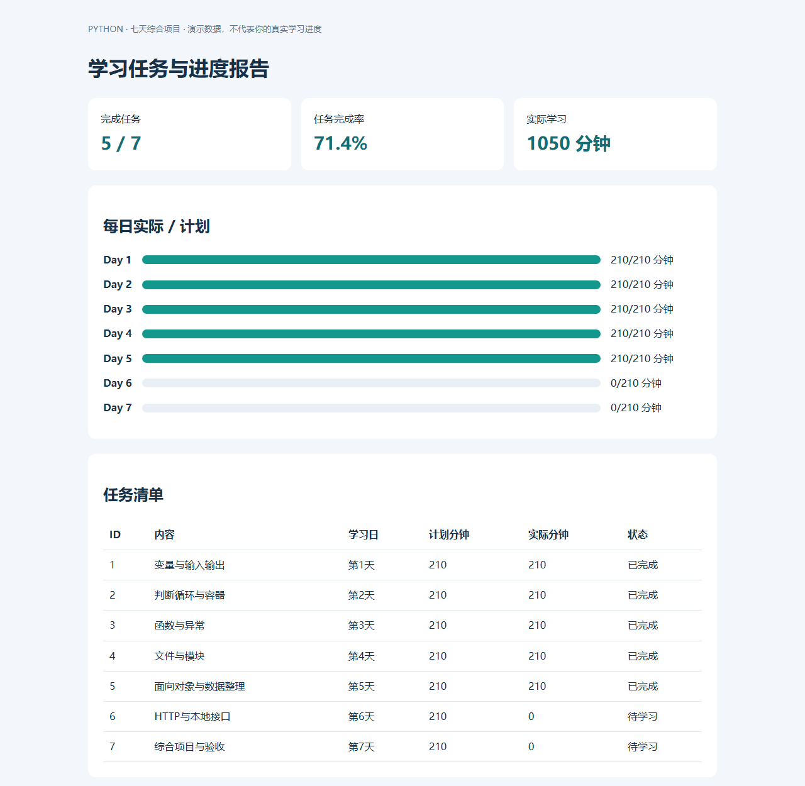

# Python 100 集学习笔记与七天实战

**每天 3–4 小时 · 基础优先 · 100 集逐集笔记 · 100 个可运行示例 · 一个完整项目**

这份笔记对应你提供的 [Bilibili 课程](https://www.bilibili.com/video/BV1rpWjevEip/)。该链接当前列出 **100 个分集，总时长 39:58:14（约 40 小时）**；标题中的“748 集”不等于此链接实际提供的分集数量。已下载并核验这 100 集的音视频轨道与时长。

整理依据是视频抽帧 OCR 和逐集画面内容核对：普通集通常每 60 秒抽一帧，另含开头与结尾；069–071 长练习集每 30 秒抽帧。共提取 **2856 帧**。这不是完整字幕或逐秒听写，可能遗漏口述解释和采样间隔中的操作；每集附原链接、时长和抽样回看位置。抽样位置用于定位画面，不代表该知识点第一次出现的准确时间。

代码是结合各集主题重新编写的学习示例，不冒充讲师源码逐行转录。笔记内完整嵌入全部配套示例、公共服务代码、项目源码和验证结果；069–071 提供代表性巩固练习，不声称还原原视频 98 道题的全部题干和答案。标为“自己动手”的题目是额外挑战，附在其前的示例不一定就是该挑战的完整解答。

代码已在本机 **Python 3.11.0** 执行，**100/100 个示例成功退出，项目 5 项测试通过**。这证明随附示例能运行，不代表网易、贴吧、翻译服务等旧网站接口已验证可用。网络练习使用本地 HTTP 演示服务；媒体例子使用自制 SVG 或测试字节，代理例子只展示配置。进程/线程日志顺序、系统名称及临时地址可能因环境不同而变化。

<a id="start"></a>
## 先运行起来

把压缩包解压，在材料根目录打开 PowerShell。基础项目只依赖标准库；运行所有示例还需要以下第三方包。使用独立虚拟环境可以隔离依赖。[venv 官方说明](https://docs.python.org/3/library/venv.html)

```powershell
python --version
python -m venv .venv
$py = '.\.venv\Scripts\python.exe'
& $py -m pip install -r .\代码\requirements.txt
& $py .\代码\lesson_003.py
& $py .\代码\run_all.py
& $py .\代码\test_project.py
```

若还未安装 Python，先从 [Python 官方下载页](https://www.python.org/downloads/) 安装适用于你的系统的 Python 3，再打开一个新终端。无须复刻视频中的旧编辑器安装步骤。项目示例按 Python 3.11 验证；其他版本可能需要适配依赖。

每集里的 `python ...` 是简写。在上述 PowerShell 环境中可改为 `& $py ...`。命令以解压后的材料根目录为工作目录；代码文件可独立编辑，网络示例需与 `code_support.py` 保持在同一目录。

实测依赖版本：

```text
requests==2.34.2
greenlet==3.5.6
gevent==26.9.0
```

<a id="plan"></a>
## Python 七天学习路径

每天 3–4 小时，基准 210 分钟；7 天共 24.5 小时。目标是独立完成一个可保存数据、可导出报告的 Python 小项目。100 集笔记全部提供，但原视频约 40 小时，无法在 21–28 小时内逐分钟看完并充分练习。七天内完成的是基础与项目主线，以及进阶内容的概览；不承诺七天掌握全部进阶技术。

每天的 210 分钟：阅读与回忆 35 分钟 → 按疑问回看视频 35 分钟 → 动手编码 100 分钟 → 验收与记录 25 分钟 → 休息 15 分钟。只有 3 小时时，把回看减至 20 分钟、阅读减至 25 分钟、休息减至 10 分钟；有 4 小时时，额外 30 分钟用于独立重写。无需按原视频时长完整播放。

| 天 | 笔记阅读范围（覆盖全部 100 集） | 重点运行 | 当天交付与验收 |
|---|---|---|---|
| 1 | 001–007 | 003–007 | 能独立运行脚本；计算一天计划分钟数，输出清晰结果 |
| 2 | 008–018 | 008–016、018 | 用字典列表存储任务，按天筛选，计算任务数；解释浅拷贝 |
| 3 | 019–028 | 019–025；026–028 概览 | 写 add_task、complete、summarize；非法输入给出具体错误 |
| 4 | 037–042、055–062 | 037–039、055–057、060；其余概览 | 用 JSON 保存与读取任务，重启后仍保留；能找出文件位置 |
| 5 | 029–036、051–054 | 029–032、034、051–054；033、035–036 概览 | 能读懂类与方法；完善数据校验；写一个独立的类练习 |
| 6 | 072–100、063–068 | 080–082、086–087、091–094、097；其余概览 | 运行本地 HTTP 请求和分页练习；说明 GET、POST、cookie 的区别 |
| 7 | 043–050、069–071；复习项目相关集 | 044、046、069–071；其余概览 | 集成任务管理器，导出网页与 CSV，通过测试，脱离教程演示一次 |

“概览”表示阅读该集要点、易错点和输出，了解用途；不要求当天掌握其全部语法。若基础练习尚未完成，保留概览标记，后续再深入。第 6、7 天内容较多，应优先运行表中的重点示例。

### 第 1 天：从零运行一个程序

1. 建立独立练习文件夹，运行 `python --version`，确认解释器可用。
2. 读 001–007，运行示例后至少改两处值；将第 007 集固定输入改成真正的 `input()`。
3. 自己写 `daily_plan.py`：输入每天可用小时，转换为分钟，扣除休息时间。
4. 验收：能说明字符串与数字的差别；不用复制示例也能写出格式化输出。

### 第 2 天：用数据表示任务

1. 用列表装 3 个任务字典，字段先取 `title`、`day`、`minutes`。
2. 写循环列出任务，按指定学习日筛选，累计总分钟。
3. 分别测试空列表、只有一个任务、同一天多个任务。
4. 验收：能解释列表、字典、集合各适合解决什么问题；改一个任务不会意外改另一个。

### 第 3 天：把逻辑拆成函数

1. 对照总笔记中的完整项目，先只阅读 `add_task`、`complete`、`summarize`。
2. 合上参考自行实现，再比较接口与输出；不要今天就照抄整个项目。
3. 练习捕获具体异常；给空标题、非法学习日、负分钟数设置错误反馈。
4. 验收：空任务完成率为 0；完成不存在的任务会报出可理解的信息。

### 第 4 天：保存、读取与排查错误

1. 学习 `Path`、`with`、UTF-8 与 JSON，完成 `load`、`save`。
2. 保存一条任务，关闭脚本重新运行，确认数据仍在。
3. 用临时练习文件测试损坏 JSON，不要覆盖自己的真实记录。
4. 验收：能指出数据文件位置，解释为何先写临时文件再替换；明白此方式不等于支持多个程序同时写入。

### 第 5 天：整理结构与数据约束

1. 用 `Student` 类理解 `self`、`__init__`、实例状态，再阅读 `CatalogClient`。
2. 任务管理器保留函数结构即可，不必为了用类而强行重构。
3. 实现或核对 `validate`：唯一正整数 ID、非空标题、1–7 的学习日、合法分钟数、布尔完成状态。
4. 验收：分别构造有效和无效数据；解释校验与计算为何分开。

### 第 6 天：理解网络数据入口

1. 安装 Requests，运行本地 HTTP 示例；服务自动绑定本机随机端口，示例结束后关闭。
2. 请求一页，再循环请求多页；把解析结果组织为字典列表。
3. 阅读 `timeout`、状态检查、表单/JSON、Session 的用法。
4. 验收：能描述 URL → 请求 → 响应 → 解析 → 保存的流程；不依赖网易、贴吧等旧接口也能完成练习。

### 第 7 天：完成项目与展示

1. 阅读完整 `study_tracker.py`，把前六天的函数接入命令行。
2. 执行新增、完成、列表、导出四个动作；建立自己的数据文件，不修改随附演示数据。
3. 运行 `python test_project.py`，确认 5 个测试通过；打开报告与 CSV 核对数字。
4. 从 069–071 的补充示例挑三个独立重写；并发只需解释用途与共享状态风险。
5. 最终演示：从空数据开始新增两条任务，完成一条，关闭再打开，导出的完成率应为 50%。

### 三个强制验收点

- 第 2 天：独立写出“筛选 + 汇总”，否则减少装饰器和多继承的投入。
- 第 4 天：数据能写入并读回，错误可定位，否则先补文件与异常。
- 第 7 天：独立演示项目全流程。成功的标准是你能解释数据怎样流动、错误怎样处理、结果怎样验证。

### 第七天之后

先用真实小需求重复项目流程，再选择一个方向：办公自动化、数据分析、Web 开发或网络数据处理。并发、装饰器、多继承与代理按项目需要再深入；这些不是入门项目的前置门槛。

<a id="catalog"></a>
## 全部分集目录

| 集 | 课程标题 | 视频时长 | 安排 |
|---|---|---|---|
| 001 | [【课前篇】Python从0到1学习指南](#lesson-001) | 2:44 | 第 1 天 · 重点练习 |
| 002 | [【语法基础】Python、PyCharm的安装与相关配置](#lesson-002) | 41:43 | 第 1 天 · 重点练习 |
| 003 | [【语法基础】了解Python，并编写第一个程序，常见的bug](#lesson-003) | 29:06 | 第 1 天 · 重点练习 |
| 004 | [【语法基础】debug、注释与输出函数](#lesson-004) | 27:22 | 第 1 天 · 重点练习 |
| 005 | [【语法基础】变量与标识符](#lesson-005) | 28:26 | 第 1 天 · 重点练习 |
| 006 | [【语法基础】数值类型、字符串与格式化输出](#lesson-006) | 32:01 | 第 1 天 · 重点练习 |
| 007 | [【语法基础】算数与赋值运算符、输入函数与转义字符](#lesson-007) | 38:22 | 第 1 天 · 重点练习 |
| 008 | [【语法基础】if判断、比较运算符与逻辑运算符](#lesson-008) | 26:48 | 第 2 天 · 重点练习 |
| 009 | [【语法基础】if-else、if-elif与if嵌套](#lesson-009) | 25:46 | 第 2 天 · 重点练习 |
| 010 | [【语法基础】while循环与循环嵌套](#lesson-010) | 29:39 | 第 2 天 · 重点练习 |
| 011 | [【语法基础】for循环与break、continue关键字](#lesson-011) | 29:24 | 第 2 天 · 重点练习 |
| 012 | [【语法基础】字符串编码与字符串常见操作](#lesson-012) | 45:04 | 第 2 天 · 重点练习 |
| 013 | [【语法基础】字符串的查找、判断、修改](#lesson-013) | 33:45 | 第 2 天 · 重点练习 |
| 014 | [【语法基础】列表的定义与增删改查，列表的推导式与嵌套](#lesson-014) | 44:11 | 第 2 天 · 重点练习 |
| 015 | [【语法基础】元组、字典的定义与字典的增删改查](#lesson-015) | 36:36 | 第 2 天 · 重点练习 |
| 016 | [【语法基础】字典的常见操作二、集合的格式及使用](#lesson-016) | 37:22 | 第 2 天 · 重点练习 |
| 017 | [【语法基础】类型转换：int、float、str、eva、tuple、list、chr（）](#lesson-017) | 29:33 | 第 2 天 · 重点练习 |
| 018 | [【语法基础】赋值、深浅拷贝、可变与不可变对象](#lesson-018) | 32:53 | 第 2 天 · 重点练习 |
| 019 | [【语法基础】函数、return返回值与形参实参](#lesson-019) | 26:03 | 第 3 天 · 重点练习 |
| 020 | [【语法基础】函数的各类参数与函数嵌套](#lesson-020) | 31:42 | 第 3 天 · 重点练习 |
| 021 | [【语法基础】作用域、匿名函数与匿名函数的参数](#lesson-021) | 41:45 | 第 3 天 · 重点练习 |
| 022 | [【语法基础】lambda结合if判断、内置函数与拆包](#lesson-022) | 46:16 | 第 3 天 · 重点练习 |
| 023 | [【语法基础】内置函数与拆包](#lesson-023) | 46:15 | 第 3 天 · 重点练习 |
| 024 | [【语法基础】异常模块与包（一）](#lesson-024) | 37:09 | 第 3 天 · 重点练习 |
| 025 | [【语法基础】异常模块与包（二）](#lesson-025) | 32:45 | 第 3 天 · 重点练习 |
| 026 | [【语法基础】闭包&装饰器](#lesson-026) | 55:23 | 第 3 天 · 概览阅读 |
| 027 | [【语法基础】标准版装饰器、语法糖](#lesson-027) | 29:17 | 第 3 天 · 概览阅读 |
| 028 | [【语法基础】被装饰的函数、多个装饰器的装饰过程](#lesson-028) | 43:01 | 第 3 天 · 概览阅读 |
| 029 | [【语法进阶】面向对象、类和对象、实例方法](#lesson-029) | 34:30 | 第 5 天 · 重点练习 |
| 030 | [【语法进阶】课程回顾、实例属性、构造函数](#lesson-030) | 39:33 | 第 5 天 · 重点练习 |
| 031 | [【语法进阶】析构函数、封装](#lesson-031) | 42:17 | 第 5 天 · 重点练习 |
| 032 | [【语法进阶】单继承&方法的重写](#lesson-032) | 34:55 | 第 5 天 · 重点练习 |
| 033 | [【语法进阶】新式类写法、多继承](#lesson-033) | 21:04 | 第 5 天 · 概览阅读 |
| 034 | [【语法进阶】多态、静态方法和类方法](#lesson-034) | 30:25 | 第 5 天 · 重点练习 |
| 035 | [【语法进阶】单例模式&魔法方法（一）](#lesson-035) | 48:24 | 第 5 天 · 概览阅读 |
| 036 | [【语法进阶】单例模式&魔法方法（二）](#lesson-036) | 46:07 | 第 5 天 · 概览阅读 |
| 037 | [【语法进阶】文件的基本操作、文件读写](#lesson-037) | 35:44 | 第 4 天 · 重点练习 |
| 038 | [【语法进阶】访问模式、文件定位操作](#lesson-038) | 34:36 | 第 4 天 · 重点练习 |
| 039 | [【语法进阶】with open&编码格式、获取目录操作](#lesson-039) | 27:57 | 第 4 天 · 重点练习 |
| 040 | [【语法进阶】可迭代对象、迭代器对象](#lesson-040) | 36:46 | 第 4 天 · 概览阅读 |
| 041 | [【语法进阶】可迭代对象和迭代器、自定义迭代器类](#lesson-041) | 26:13 | 第 4 天 · 概览阅读 |
| 042 | [【语法进阶】生成器、三者关系](#lesson-042) | 34:35 | 第 4 天 · 概览阅读 |
| 043 | [【语法进阶】线程特点](#lesson-043) | 29:14 | 第 7 天 · 概览阅读 |
| 044 | [【语法进阶】线程同步、进程介绍](#lesson-044) | 25:59 | 第 7 天 · 重点练习 |
| 045 | [【语法进阶】进程常用的属性、常用方法](#lesson-045) | 29:48 | 第 7 天 · 概览阅读 |
| 046 | [【语法进阶】进程语法结构、进程间的通信](#lesson-046) | 25:02 | 第 7 天 · 重点练习 |
| 047 | [【语法进阶】多任务、简单多线程的实现与多线程的方法](#lesson-047) | 24:06 | 第 7 天 · 概览阅读 |
| 048 | [【语法进阶】多线程的特点与同步、互斥锁](#lesson-048) | 28:45 | 第 7 天 · 概览阅读 |
| 049 | [【语法进阶】协程操作与greenlet使用](#lesson-049) | 30:06 | 第 7 天 · 概览阅读 |
| 050 | [【语法进阶】genent的使用与总结](#lesson-050) | 33:08 | 第 7 天 · 概览阅读 |
| 051 | [【语法进阶】正则表达式、匹配单个字符](#lesson-051) | 34:50 | 第 5 天 · 重点练习 |
| 052 | [【语法进阶】匹配多个字符与匹配开头结尾](#lesson-052) | 23:29 | 第 5 天 · 重点练习 |
| 053 | [【语法进阶】匹配分组](#lesson-053) | 29:17 | 第 5 天 · 重点练习 |
| 054 | [【语法进阶】高级用法、贪婪与非贪婪、原生字符串](#lesson-054) | 32:13 | 第 5 天 · 重点练习 |
| 055 | [【语法进阶】os模块一](#lesson-055) | 11:45 | 第 4 天 · 重点练习 |
| 056 | [【语法进阶】os模块二](#lesson-056) | 8:57 | 第 4 天 · 重点练习 |
| 057 | [【语法进阶】sys模块](#lesson-057) | 7:21 | 第 4 天 · 重点练习 |
| 058 | [【语法进阶】time模块之三种时间表示](#lesson-058) | 13:28 | 第 4 天 · 概览阅读 |
| 059 | [【语法进阶】time模块之时间元组与时间字符串相互转换](#lesson-059) | 5:27 | 第 4 天 · 概览阅读 |
| 060 | [【语法进阶】logging模块一](#lesson-060) | 6:34 | 第 4 天 · 重点练习 |
| 061 | [【语法进阶】logging模块二](#lesson-061) | 9:13 | 第 4 天 · 概览阅读 |
| 062 | [【语法进阶】random模块](#lesson-062) | 7:51 | 第 4 天 · 概览阅读 |
| 063 | [【语法进阶】虚拟机安装](#lesson-063) | 6:34 | 第 6 天 · 概览阅读 |
| 064 | [【语法进阶】关机重启命令](#lesson-064) | 5:11 | 第 6 天 · 概览阅读 |
| 065 | [【语法进阶】目录操作命令](#lesson-065) | 19:56 | 第 6 天 · 概览阅读 |
| 066 | [【语法进阶】文件操作命令](#lesson-066) | 14:33 | 第 6 天 · 概览阅读 |
| 067 | [【语法进阶】压缩文件操作命令](#lesson-067) | 5:29 | 第 6 天 · 概览阅读 |
| 068 | [【语法进阶】其他常用命令](#lesson-068) | 6:59 | 第 6 天 · 概览阅读 |
| 069 | [【练习题01-33】](#lesson-069) | 1:50:13 | 第 7 天 · 重点练习 |
| 070 | [【练习题34-66】](#lesson-070) | 1:18:33 | 第 7 天 · 重点练习 |
| 071 | [【练习题67-98】](#lesson-071) | 1:12:14 | 第 7 天 · 重点练习 |
| 072 | [【网络爬虫】网络请求](#lesson-072) | 5:52 | 第 6 天 · 概览阅读 |
| 073 | [【网络爬虫】爬虫的概念与分类](#lesson-073) | 5:30 | 第 6 天 · 概览阅读 |
| 074 | [【网络爬虫】基本流程和robots协议](#lesson-074) | 9:10 | 第 6 天 · 概览阅读 |
| 075 | [【网络爬虫】爬虫的分类](#lesson-075) | 5:30 | 第 6 天 · 概览阅读 |
| 076 | [【网络爬虫】网络请求步骤](#lesson-076) | 7:00 | 第 6 天 · 概览阅读 |
| 077 | [【网络爬虫】http和https协议](#lesson-077) | 7:50 | 第 6 天 · 概览阅读 |
| 078 | [【网络爬虫】浏览器network](#lesson-078) | 7:35 | 第 6 天 · 概览阅读 |
| 079 | [【网络爬虫】请求头的介绍](#lesson-079) | 8:40 | 第 6 天 · 概览阅读 |
| 080 | [【网络爬虫】requests基本使用](#lesson-080) | 8:24 | 第 6 天 · 重点练习 |
| 081 | [【网络爬虫】响应的保存](#lesson-081) | 6:29 | 第 6 天 · 重点练习 |
| 082 | [【网络爬虫】响应对象的其他属性](#lesson-082) | 8:53 | 第 6 天 · 重点练习 |
| 083 | [【网络爬虫】用户代理的介绍](#lesson-083) | 10:38 | 第 6 天 · 概览阅读 |
| 084 | [【网络爬虫】user-agent池的介绍](#lesson-084) | 7:35 | 第 6 天 · 概览阅读 |
| 085 | [【网络爬虫】浏览器发送请求原理](#lesson-085) | 6:58 | 第 6 天 · 概览阅读 |
| 086 | [【网络爬虫】url传参及转译](#lesson-086) | 8:35 | 第 6 天 · 重点练习 |
| 087 | [【网络爬虫】url传参的两种方式](#lesson-087) | 10:35 | 第 6 天 · 重点练习 |
| 088 | [【网络爬虫】网易云单张图片案例](#lesson-088) | 4:47 | 第 6 天 · 概览阅读 |
| 089 | [【网络爬虫】网易云单首歌曲案例](#lesson-089) | 6:28 | 第 6 天 · 概览阅读 |
| 090 | [【网络爬虫】网易云单个mv案例](#lesson-090) | 5:01 | 第 6 天 · 概览阅读 |
| 091 | [【网络爬虫】贴吧单页获取](#lesson-091) | 4:59 | 第 6 天 · 重点练习 |
| 092 | [【网络爬虫】贴吧翻页](#lesson-092) | 9:20 | 第 6 天 · 重点练习 |
| 093 | [【网络爬虫】面向对象改写翻页](#lesson-093) | 9:08 | 第 6 天 · 重点练习 |
| 094 | [【网络爬虫】post请求](#lesson-094) | 5:04 | 第 6 天 · 重点练习 |
| 095 | [【网络爬虫】使用cookie获取登录后的页面数据](#lesson-095) | 5:30 | 第 6 天 · 概览阅读 |
| 096 | [【网络爬虫】post请求-金山翻译](#lesson-096) | 8:46 | 第 6 天 · 概览阅读 |
| 097 | [【网络爬虫】session自动携带cookie](#lesson-097) | 5:57 | 第 6 天 · 重点练习 |
| 098 | [【网络爬虫】cookie池的介绍](#lesson-098) | 5:13 | 第 6 天 · 概览阅读 |
| 099 | [【网络爬虫】代理ip介绍](#lesson-099) | 6:43 | 第 6 天 · 概览阅读 |
| 100 | [【网络爬虫】代理ip使用](#lesson-100) | 6:22 | 第 6 天 · 概览阅读 |

<a id="lesson-001"></a>
## 001 【课前篇】Python从0到1学习指南

**时长 2:44 · 第 1 天 · 重点练习** | [原视频](https://www.bilibili.com/video/BV1rpWjevEip/?p=1) | 抽样回看：[0:30](https://www.bilibili.com/video/BV1rpWjevEip/?p=1&t=30) · [1:30](https://www.bilibili.com/video/BV1rpWjevEip/?p=1&t=90) · [2:33](https://www.bilibili.com/video/BV1rpWjevEip/?p=1&t=153)

### 课程思路与补充解释

先建立学习地图：基础语法解决“怎么表达”，函数与文件解决“怎么组织和保存”，项目把知识连起来。学习时采用读一段、改一段、独立写一段的循环。

**易错点与校正：** 不要用看完多少视频代替能否独立写程序。

### 完整配套示例

文件：`代码/lesson_001.py`。运行：`python "代码/lesson_001.py"`。

```python
# 配套重写示例，非课程源码逐行转录。
print("学习顺序：基础语法 -> 函数与文件 -> 小项目 -> 进阶拓展")
```

### 本机实际运行结果

```text
学习顺序：基础语法 -> 函数与文件 -> 小项目 -> 进阶拓展
```

### 自己动手

用一句话写下你想自动化的日常任务，并列出输入、处理、输出。

验收方法：先写出你预测的结果，再运行；至少修改一处输入，并解释结果为什么变化。

<a id="lesson-002"></a>
## 002 【语法基础】Python、PyCharm的安装与相关配置

**时长 41:43 · 第 1 天 · 重点练习** | [原视频](https://www.bilibili.com/video/BV1rpWjevEip/?p=2) | 抽样回看：[8:30](https://www.bilibili.com/video/BV1rpWjevEip/?p=2&t=510) · [27:30](https://www.bilibili.com/video/BV1rpWjevEip/?p=2&t=1650) · [37:30](https://www.bilibili.com/video/BV1rpWjevEip/?p=2&t=2250)

### 课程思路与补充解释

环境安装的目标是让解释器能执行 .py 文件，编辑器只是写代码的工具。课程演示旧版 Python/PyCharm；本笔记使用已实测的 Python 3.11 环境，命令行先确认解释器再建立项目环境。

**易错点与校正：** 安装多个 Python 后，pip 与 python 可能指向不同环境；优先使用 python -m pip。

### 完整配套示例

文件：`代码/lesson_002.py`。运行：`python "代码/lesson_002.py"`。

```python
# 配套重写示例，非课程源码逐行转录。
import sys
print("Python主版本:", sys.version_info.major)
print("环境检查:", "可运行")
```

### 本机实际运行结果

```text
Python主版本: 3
环境检查: 可运行
```

### 自己动手

运行版本检查，再用自己的文件名保存并运行一个脚本。

验收方法：先写出你预测的结果，再运行；至少修改一处输入，并解释结果为什么变化。

<a id="lesson-003"></a>
## 003 【语法基础】了解Python，并编写第一个程序，常见的bug

**时长 29:06 · 第 1 天 · 重点练习** | [原视频](https://www.bilibili.com/video/BV1rpWjevEip/?p=3) | 抽样回看：[8:30](https://www.bilibili.com/video/BV1rpWjevEip/?p=3&t=510) · [15:30](https://www.bilibili.com/video/BV1rpWjevEip/?p=3&t=930) · [28:55](https://www.bilibili.com/video/BV1rpWjevEip/?p=3&t=1735)

### 课程思路与补充解释

认识源代码、解释器和控制台；print 可以输出字符串和表达式的结果。字符串需要成对引号，语句与代码块遵循 Python 的缩进规则。

**易错点与校正：** 英文标点与中文标点不同；顶层不应随意缩进，函数或条件内部则必须按代码块缩进。

### 完整配套示例

文件：`代码/lesson_003.py`。运行：`python "代码/lesson_003.py"`。

```python
# 配套重写示例，非课程源码逐行转录。
print("Hello, Python!")
print(2 + 3)
```

### 本机实际运行结果

```text
Hello, Python!
5
```

### 自己动手

让程序输出姓名、学习目标，以及一个算术表达式的结果。

验收方法：先写出你预测的结果，再运行；至少修改一处输入，并解释结果为什么变化。

<a id="lesson-004"></a>
## 004 【语法基础】debug、注释与输出函数

**时长 27:22 · 第 1 天 · 重点练习** | [原视频](https://www.bilibili.com/video/BV1rpWjevEip/?p=4) | 抽样回看：[3:30](https://www.bilibili.com/video/BV1rpWjevEip/?p=4&t=210) · [11:30](https://www.bilibili.com/video/BV1rpWjevEip/?p=4&t=690) · [27:11](https://www.bilibili.com/video/BV1rpWjevEip/?p=4&t=1631)

### 课程思路与补充解释

注释解释代码意图，print 帮助观察变量，断点允许暂停并逐步检查状态。print 的 sep 控制多个值之间的分隔，end 控制结尾。

**易错点与校正：** 三引号创建字符串；位于特定位置时可成为文档字符串，并不等同于真正的多行注释。

### 完整配套示例

文件：`代码/lesson_004.py`。运行：`python "代码/lesson_004.py"`。

```python
# 配套重写示例，非课程源码逐行转录。
# 注释不会执行；断点可观察 total 的变化。
price = 12
count = 3
total = price * count
print("总价", total, sep=": ", end="元\n")
```

### 本机实际运行结果

```text
总价: 36元
```

### 自己动手

把示例中的数量改成 5，先算出结果，再用断点核对 total。

验收方法：先写出你预测的结果，再运行；至少修改一处输入，并解释结果为什么变化。

<a id="lesson-005"></a>
## 005 【语法基础】变量与标识符

**时长 28:26 · 第 1 天 · 重点练习** | [原视频](https://www.bilibili.com/video/BV1rpWjevEip/?p=5) | 抽样回看：[6:30](https://www.bilibili.com/video/BV1rpWjevEip/?p=5&t=390) · [9:30](https://www.bilibili.com/video/BV1rpWjevEip/?p=5&t=570) · [22:30](https://www.bilibili.com/video/BV1rpWjevEip/?p=5&t=1350)

### 课程思路与补充解释

变量名绑定对象，赋值可重新绑定；命名应表达含义并区分大小写。一般变量与函数使用 snake_case，类名通常使用 PascalCase。

**易错点与校正：** 变量无需先声明类型，但同一个名字反复混用含义会让程序难读。

### 完整配套示例

文件：`代码/lesson_005.py`。运行：`python "代码/lesson_005.py"`。

```python
# 配套重写示例，非课程源码逐行转录。
student_name = "小林"
study_minutes = 90
study_minutes += 30
print(student_name, study_minutes)
```

### 本机实际运行结果

```text
小林 120
```

### 自己动手

增加已完成分钟数，计算剩余学习时间，使用三个有含义的变量名。

验收方法：先写出你预测的结果，再运行；至少修改一处输入，并解释结果为什么变化。

<a id="lesson-006"></a>
## 006 【语法基础】数值类型、字符串与格式化输出

**时长 32:01 · 第 1 天 · 重点练习** | [原视频](https://www.bilibili.com/video/BV1rpWjevEip/?p=6) | 抽样回看：[8:30](https://www.bilibili.com/video/BV1rpWjevEip/?p=6&t=510) · [12:30](https://www.bilibili.com/video/BV1rpWjevEip/?p=6&t=750) · [28:30](https://www.bilibili.com/video/BV1rpWjevEip/?p=6&t=1710)

### 课程思路与补充解释

区分整数、浮点数和字符串，运算的意义取决于对象类型。课程展示格式化输出，本笔记用 f-string 表达插值和小数位数。

**易错点与校正：** 显示为两位小数不等于底层浮点数能精确表示所有小数。

### 完整配套示例

文件：`代码/lesson_006.py`。运行：`python "代码/lesson_006.py"`。

```python
# 配套重写示例，非课程源码逐行转录。
price = 19.9
quantity = 3
print(f"商品数量={quantity}, 总价={price * quantity:.2f}")
print(type(quantity).__name__, type(price).__name__)
```

### 本机实际运行结果

```text
商品数量=3, 总价=59.70
int float
```

### 自己动手

输入单价与数量，输出含两位小数的总价，并检查各变量类型。

验收方法：先写出你预测的结果，再运行；至少修改一处输入，并解释结果为什么变化。

<a id="lesson-007"></a>
## 007 【语法基础】算数与赋值运算符、输入函数与转义字符

**时长 38:22 · 第 1 天 · 重点练习** | [原视频](https://www.bilibili.com/video/BV1rpWjevEip/?p=7) | 抽样回看：[7:30](https://www.bilibili.com/video/BV1rpWjevEip/?p=7&t=450) · [20:30](https://www.bilibili.com/video/BV1rpWjevEip/?p=7&t=1230) · [28:30](https://www.bilibili.com/video/BV1rpWjevEip/?p=7&t=1710)

### 课程思路与补充解释

掌握算术、复合赋值、input 和转义字符。/ 是除法，// 是向下取整的整除，% 是余数；input 返回字符串，需要显式转换。

**易错点与校正：** 输入不是数字时 int 会失败；示例用 mock 提供固定输入便于自动验证，手动练习时移除 mock。

### 完整配套示例

文件：`代码/lesson_007.py`。运行：`python "代码/lesson_007.py"`。

```python
# 配套重写示例，非课程源码逐行转录。
from unittest.mock import patch
with patch("builtins.input", return_value="7"):
    days = int(input("学习天数："))
print("每天分钟:", 1470 // days, "余数:", 1470 % days)
print("第一行\n第二行")
```

### 本机实际运行结果

```text
每天分钟: 210 余数: 0
第一行
第二行
```

### 自己动手

把 7 天总时长平均分配，打印每天分钟数和无法均分的余数。

验收方法：先写出你预测的结果，再运行；至少修改一处输入，并解释结果为什么变化。

<a id="lesson-008"></a>
## 008 【语法基础】if判断、比较运算符与逻辑运算符

**时长 26:48 · 第 2 天 · 重点练习** | [原视频](https://www.bilibili.com/video/BV1rpWjevEip/?p=8) | 抽样回看：[8:30](https://www.bilibili.com/video/BV1rpWjevEip/?p=8&t=510) · [9:30](https://www.bilibili.com/video/BV1rpWjevEip/?p=8&t=570) · [21:30](https://www.bilibili.com/video/BV1rpWjevEip/?p=8&t=1290)

### 课程思路与补充解释

比较运算生成布尔结果，and/or/not 用于组合条件；if 根据条件选择执行路径。理解短路求值，能避免不必要的计算。

**易错点与校正：** 判断相等使用 ==，赋值使用 =；and/or 也可能返回操作数本身，不只返回布尔值。

### 完整配套示例

文件：`代码/lesson_008.py`。运行：`python "代码/lesson_008.py"`。

```python
# 配套重写示例，非课程源码逐行转录。
age = 20
has_ticket = True
if age >= 18 and has_ticket:
    print("允许进入")
print(not False, 1 < age < 100)
```

### 本机实际运行结果

```text
允许进入
True True
```

### 自己动手

写一个同时检查年龄和票据的入场判断，并测试每种组合。

验收方法：先写出你预测的结果，再运行；至少修改一处输入，并解释结果为什么变化。

<a id="lesson-009"></a>
## 009 【语法基础】if-else、if-elif与if嵌套

**时长 25:46 · 第 2 天 · 重点练习** | [原视频](https://www.bilibili.com/video/BV1rpWjevEip/?p=9) | 抽样回看：[8:30](https://www.bilibili.com/video/BV1rpWjevEip/?p=9&t=510) · [13:30](https://www.bilibili.com/video/BV1rpWjevEip/?p=9&t=810) · [25:30](https://www.bilibili.com/video/BV1rpWjevEip/?p=9&t=1530)

### 课程思路与补充解释

if/elif/else 适合互斥分支，嵌套 if 适合依赖前提的二次判断；简单二选一可用条件表达式。把边界值写出来可减少漏判。

**易错点与校正：** 分数区间应从高到低判断；多个独立 if 与一组 elif 的执行次数不同。

### 完整配套示例

文件：`代码/lesson_009.py`。运行：`python "代码/lesson_009.py"`。

```python
# 配套重写示例，非课程源码逐行转录。
score = 86
if score >= 90:
    grade = "优秀"
elif score >= 60:
    grade = "及格"
else:
    grade = "继续练习"
print(grade)
```

### 本机实际运行结果

```text
及格
```

### 自己动手

验证 59、60、89、90、100 的等级结果，并拒绝超出范围的输入。

验收方法：先写出你预测的结果，再运行；至少修改一处输入，并解释结果为什么变化。

<a id="lesson-010"></a>
## 010 【语法基础】while循环与循环嵌套

**时长 29:39 · 第 2 天 · 重点练习** | [原视频](https://www.bilibili.com/video/BV1rpWjevEip/?p=10) | 抽样回看：[1:30](https://www.bilibili.com/video/BV1rpWjevEip/?p=10&t=90) · [16:30](https://www.bilibili.com/video/BV1rpWjevEip/?p=10&t=990) · [25:30](https://www.bilibili.com/video/BV1rpWjevEip/?p=10&t=1530)

### 课程思路与补充解释

while 在条件成立时重复执行，通常由初始化、循环条件、状态更新组成。累加器记录结果，计数器推动循环终止。

**易错点与校正：** 忘记更新变量会造成死循环；先确定是否包含最后一个值。

### 完整配套示例

文件：`代码/lesson_010.py`。运行：`python "代码/lesson_010.py"`。

```python
# 配套重写示例，非课程源码逐行转录。
n = 1
total = 0
while n <= 5:
    total += n
    n += 1
print("1到5的和:", total)
for row in range(1, 4):
    print("*" * row)
```

### 本机实际运行结果

```text
1到5的和: 15
*
**
***
```

### 自己动手

不用 sum 求 1 到 100 的和，再修改为只累计偶数。

验收方法：先写出你预测的结果，再运行；至少修改一处输入，并解释结果为什么变化。

<a id="lesson-011"></a>
## 011 【语法基础】for循环与break、continue关键字

**时长 29:24 · 第 2 天 · 重点练习** | [原视频](https://www.bilibili.com/video/BV1rpWjevEip/?p=11) | 抽样回看：[7:30](https://www.bilibili.com/video/BV1rpWjevEip/?p=11&t=450) · [16:30](https://www.bilibili.com/video/BV1rpWjevEip/?p=11&t=990) · [20:30](https://www.bilibili.com/video/BV1rpWjevEip/?p=11&t=1230)

### 课程思路与补充解释

for 适合遍历可迭代对象；range 的终点不包含在结果中。break 结束最近一层循环，continue 跳过当前轮剩余语句。

**易错点与校正：** 嵌套循环中的 break 不会自动结束外层；while 中 continue 可能跳过计数器更新。

### 完整配套示例

文件：`代码/lesson_011.py`。运行：`python "代码/lesson_011.py"`。

```python
# 配套重写示例，非课程源码逐行转录。
for number in range(1, 8):
    if number == 2:
        continue
    if number == 5:
        break
    print(number)
```

### 本机实际运行结果

```text
1
3
4
```

### 自己动手

遍历 1 到 20，跳过 3 的倍数，到 17 时结束，并解释输出。

验收方法：先写出你预测的结果，再运行；至少修改一处输入，并解释结果为什么变化。

<a id="lesson-012"></a>
## 012 【语法基础】字符串编码与字符串常见操作

**时长 45:04 · 第 2 天 · 重点练习** | [原视频](https://www.bilibili.com/video/BV1rpWjevEip/?p=12) | 抽样回看：[13:30](https://www.bilibili.com/video/BV1rpWjevEip/?p=12&t=810) · [16:30](https://www.bilibili.com/video/BV1rpWjevEip/?p=12&t=990) · [40:30](https://www.bilibili.com/video/BV1rpWjevEip/?p=12&t=2430)

### 课程思路与补充解释

字符串是不可变的 Unicode 文本序列，支持索引、切片、拼接、重复和成员判断。网络与文件中的 bytes 需要通过编码与 str 相互转换。

**易错点与校正：** 索引越界会报错，切片通常容忍越界；UTF-8 字节数不等于字符数。

### 完整配套示例

文件：`代码/lesson_012.py`。运行：`python "代码/lesson_012.py"`。

```python
# 配套重写示例，非课程源码逐行转录。
text = "Python中文"
encoded = text.encode("utf-8")
print(encoded.decode("utf-8"))
print(text[:6], text[-2:], text[::-1])
```

### 本机实际运行结果

```text
Python中文
Python 中文 文中nohtyP
```

### 自己动手

对一个中文名字做切片，并比较 len(text) 与 len(text.encode('utf-8'))。

验收方法：先写出你预测的结果，再运行；至少修改一处输入，并解释结果为什么变化。

<a id="lesson-013"></a>
## 013 【语法基础】字符串的查找、判断、修改

**时长 33:45 · 第 2 天 · 重点练习** | [原视频](https://www.bilibili.com/video/BV1rpWjevEip/?p=13) | 抽样回看：[7:30](https://www.bilibili.com/video/BV1rpWjevEip/?p=13&t=450) · [11:30](https://www.bilibili.com/video/BV1rpWjevEip/?p=13&t=690) · [31:30](https://www.bilibili.com/video/BV1rpWjevEip/?p=13&t=1890)

### 课程思路与补充解释

字符串方法可用于查找、计数、判断、替换和拆分。用 strip 清理边缘空白，用 split 拆字段，再用 join 组装。

**易错点与校正：** find 找不到返回 -1，index 找不到抛异常；replace 返回新字符串，不会修改原对象。

### 完整配套示例

文件：`代码/lesson_013.py`。运行：`python "代码/lesson_013.py"`。

```python
# 配套重写示例，非课程源码逐行转录。
text = "  python,python,java  "
cleaned = text.strip().replace("java", "SQL")
print(cleaned.split(","))
print(cleaned.find("SQL"), "123".isdigit())
```

### 本机实际运行结果

```text
['python', 'python', 'SQL']
14 True
```

### 自己动手

把带空格的逗号分隔标签清洗为整齐的标签列表。

验收方法：先写出你预测的结果，再运行；至少修改一处输入，并解释结果为什么变化。

<a id="lesson-014"></a>
## 014 【语法基础】列表的定义与增删改查，列表的推导式与嵌套

**时长 44:11 · 第 2 天 · 重点练习** | [原视频](https://www.bilibili.com/video/BV1rpWjevEip/?p=14) | 抽样回看：[10:30](https://www.bilibili.com/video/BV1rpWjevEip/?p=14&t=630) · [26:30](https://www.bilibili.com/video/BV1rpWjevEip/?p=14&t=1590) · [43:30](https://www.bilibili.com/video/BV1rpWjevEip/?p=14&t=2610)

### 课程思路与补充解释

列表适合保存有顺序、可修改的一组数据。掌握 append/extend/insert、索引更新、pop/remove，以及排序、切片和推导式。

**易错点与校正：** append 加一个对象，extend 展开可迭代对象；sort 原地修改且返回 None。

### 完整配套示例

文件：`代码/lesson_014.py`。运行：`python "代码/lesson_014.py"`。

```python
# 配套重写示例，非课程源码逐行转录。
tasks = ["变量", "循环"]
tasks.append("函数")
tasks[0] = "类型"
removed = tasks.pop(1)
print(tasks, removed)
print([n * n for n in range(5) if n % 2 == 0])
```

### 本机实际运行结果

```text
['类型', '函数'] 循环
[0, 4, 16]
```

### 自己动手

做一个课程列表，完成新增、删除、去重和按名称排序。

验收方法：先写出你预测的结果，再运行；至少修改一处输入，并解释结果为什么变化。

<a id="lesson-015"></a>
## 015 【语法基础】元组、字典的定义与字典的增删改查

**时长 36:36 · 第 2 天 · 重点练习** | [原视频](https://www.bilibili.com/video/BV1rpWjevEip/?p=15) | 抽样回看：[10:30](https://www.bilibili.com/video/BV1rpWjevEip/?p=15&t=630) · [22:30](https://www.bilibili.com/video/BV1rpWjevEip/?p=15&t=1350) · [25:30](https://www.bilibili.com/video/BV1rpWjevEip/?p=15&t=1530)

### 课程思路与补充解释

元组表达固定结构，字典用键映射值；可以把单条任务表达为字典，多条任务组成列表。读取可能不存在的键可使用 get。

**易错点与校正：** 单元素元组需要逗号；字典在本笔记使用的 Python 版本中保留插入顺序，不应把它概括为“无序”。

### 完整配套示例

文件：`代码/lesson_015.py`。运行：`python "代码/lesson_015.py"`。

```python
# 配套重写示例，非课程源码逐行转录。
point = (3, 4)
student = {"name": "小林", "score": 80}
student["score"] = 90
student["city"] = "杭州"
del student["city"]
print(point, student)
```

### 本机实际运行结果

```text
(3, 4) {'name': '小林', 'score': 90}
```

### 自己动手

创建含 title、day、minutes 的任务字典，更新学习时间并读取可选备注。

验收方法：先写出你预测的结果，再运行；至少修改一处输入，并解释结果为什么变化。

<a id="lesson-016"></a>
## 016 【语法基础】字典的常见操作二、集合的格式及使用

**时长 37:22 · 第 2 天 · 重点练习** | [原视频](https://www.bilibili.com/video/BV1rpWjevEip/?p=16) | 抽样回看：[1:30](https://www.bilibili.com/video/BV1rpWjevEip/?p=16&t=90) · [15:30](https://www.bilibili.com/video/BV1rpWjevEip/?p=16&t=930) · [27:30](https://www.bilibili.com/video/BV1rpWjevEip/?p=16&t=1650)

### 课程思路与补充解释

字典的 keys/values/items 支持遍历不同视角；集合适合去重、成员判断和交并差运算。选择容器时先看业务操作。

**易错点与校正：** 空集合是 set()，{} 是空字典；集合元素和字典键需要可哈希，普通列表不能直接作为它们。

### 完整配套示例

文件：`代码/lesson_016.py`。运行：`python "代码/lesson_016.py"`。

```python
# 配套重写示例，非课程源码逐行转录。
scores = {"小林": 90, "小周": 85}
print(list(scores.items()))
print(scores.get("新同学", 0))
a, b = {1, 2, 3}, {3, 4}
print(sorted(a & b), sorted(a | b), sorted(a - b))
```

### 本机实际运行结果

```text
[('小林', 90), ('小周', 85)]
0
[3] [1, 2, 3, 4] [1, 2]
```

### 自己动手

比较计划课程与已完成课程，求剩余、共同与全部课程集合。

验收方法：先写出你预测的结果，再运行；至少修改一处输入，并解释结果为什么变化。

<a id="lesson-017"></a>
## 017 【语法基础】类型转换：int、float、str、eva、tuple、list、chr（）

**时长 29:33 · 第 2 天 · 重点练习** | [原视频](https://www.bilibili.com/video/BV1rpWjevEip/?p=17) | 抽样回看：[7:30](https://www.bilibili.com/video/BV1rpWjevEip/?p=17&t=450) · [14:30](https://www.bilibili.com/video/BV1rpWjevEip/?p=17&t=870) · [20:30](https://www.bilibili.com/video/BV1rpWjevEip/?p=17&t=1230)

### 课程思路与补充解释

显式类型转换连接输入与计算，例如字符串转整数、序列互转。课程涉及 eval，练习改用 ast.literal_eval 读取受限字面量，结构化交换更适合 JSON。

**易错点与校正：** 不要执行来自用户或网络的任意表达式；literal_eval 也不适合无限大小的不可信输入。

### 完整配套示例

文件：`代码/lesson_017.py`。运行：`python "代码/lesson_017.py"`。

```python
# 配套重写示例，非课程源码逐行转录。
import ast
print(int("12"), float("3.5"), str(7))
print(tuple([1, 2]), list((3, 4)), chr(65))
print(ast.literal_eval("[1, 2, 3]"))
# 不对用户输入使用 eval；结构化数据可用 json。
```

### 本机实际运行结果

```text
12 3.5 7
(1, 2) [3, 4] A
[1, 2, 3]
```

### 自己动手

读取一个数字列表的文本，校验确实是列表且元素都是数字，再求和。

验收方法：先写出你预测的结果，再运行；至少修改一处输入，并解释结果为什么变化。

<a id="lesson-018"></a>
## 018 【语法基础】赋值、深浅拷贝、可变与不可变对象

**时长 32:53 · 第 2 天 · 重点练习** | [原视频](https://www.bilibili.com/video/BV1rpWjevEip/?p=18) | 抽样回看：[8:30](https://www.bilibili.com/video/BV1rpWjevEip/?p=18&t=510) · [20:30](https://www.bilibili.com/video/BV1rpWjevEip/?p=18&t=1230) · [30:30](https://www.bilibili.com/video/BV1rpWjevEip/?p=18&t=1830)

### 课程思路与补充解释

赋值共享引用，浅拷贝只复制外层容器，深拷贝递归复制内部对象。通过修改嵌套列表可以直接观察三者差别。

**易错点与校正：** 对象是否可变与变量能否重新赋值是两件事；浅拷贝不能隔离嵌套可变数据。

### 完整配套示例

文件：`代码/lesson_018.py`。运行：`python "代码/lesson_018.py"`。

```python
# 配套重写示例，非课程源码逐行转录。
import copy
original = [[1], [2]]
alias = original
shallow = copy.copy(original)
deep = copy.deepcopy(original)
original[0].append(9)
print(alias, shallow, deep)
print(alias is original, shallow is original)
```

### 本机实际运行结果

```text
[[1, 9], [2]] [[1, 9], [2]] [[1], [2]]
True False
```

### 自己动手

为任务列表做一份副本，修改副本内的字典，分别验证浅拷贝和深拷贝结果。

验收方法：先写出你预测的结果，再运行；至少修改一处输入，并解释结果为什么变化。

<a id="lesson-019"></a>
## 019 【语法基础】函数、return返回值与形参实参

**时长 26:03 · 第 3 天 · 重点练习** | [原视频](https://www.bilibili.com/video/BV1rpWjevEip/?p=19) | 抽样回看：[8:30](https://www.bilibili.com/video/BV1rpWjevEip/?p=19&t=510) · [11:30](https://www.bilibili.com/video/BV1rpWjevEip/?p=19&t=690) · [24:30](https://www.bilibili.com/video/BV1rpWjevEip/?p=19&t=1470)

### 课程思路与补充解释

函数把一段处理逻辑变为可命名、可复用的操作。参数接收输入，return 交还结果，调用者决定如何使用结果。

**易错点与校正：** print 只负责显示，不能代替 return；没有显式返回时结果为 None。

### 完整配套示例

文件：`代码/lesson_019.py`。运行：`python "代码/lesson_019.py"`。

```python
# 配套重写示例，非课程源码逐行转录。
def average(a, b):
    return (a + b) / 2
result = average(80, 90)
print("平均分:", result)
```

### 本机实际运行结果

```text
平均分: 85.0
```

### 自己动手

写一个计算完成率的函数，处理总任务数为零的情况。

验收方法：先写出你预测的结果，再运行；至少修改一处输入，并解释结果为什么变化。

<a id="lesson-020"></a>
## 020 【语法基础】函数的各类参数与函数嵌套

**时长 31:42 · 第 3 天 · 重点练习** | [原视频](https://www.bilibili.com/video/BV1rpWjevEip/?p=20) | 抽样回看：[1:30](https://www.bilibili.com/video/BV1rpWjevEip/?p=20&t=90) · [19:30](https://www.bilibili.com/video/BV1rpWjevEip/?p=20&t=1170) · [23:30](https://www.bilibili.com/video/BV1rpWjevEip/?p=20&t=1410)

### 课程思路与补充解释

位置参数、关键字参数、默认参数与 `*args/**kwargs` 解决不同调用方式。定义函数时让必填参数明确，让可选参数有合理默认值。

**易错点与校正：** 可变默认对象在定义时创建并被后续调用共享；使用 None 后在函数内部创建容器。

### 完整配套示例

文件：`代码/lesson_020.py`。运行：`python "代码/lesson_020.py"`。

```python
# 配套重写示例，非课程源码逐行转录。
def total(*values, discount=0, **metadata):
    return sum(values) - discount, metadata.get("owner", "匿名")
print(total(10, 20, discount=5, owner="小林"))
def append_item(value, items=None):
    if items is None:
        items = []
    items.append(value)
    return items
print(append_item(1), append_item(2))
```

### 本机实际运行结果

```text
(25, '小林')
[1] [2]
```

### 自己动手

写一个汇总多个学习时长的函数，支持可选的学习者姓名。

验收方法：先写出你预测的结果，再运行；至少修改一处输入，并解释结果为什么变化。

<a id="lesson-021"></a>
## 021 【语法基础】作用域、匿名函数与匿名函数的参数

**时长 41:45 · 第 3 天 · 重点练习** | [原视频](https://www.bilibili.com/video/BV1rpWjevEip/?p=21) | 抽样回看：[12:30](https://www.bilibili.com/video/BV1rpWjevEip/?p=21&t=750) · [17:30](https://www.bilibili.com/video/BV1rpWjevEip/?p=21&t=1050) · [40:30](https://www.bilibili.com/video/BV1rpWjevEip/?p=21&t=2430)

### 课程思路与补充解释

名字解析遵循局部、外层函数、模块全局、内置的范围关系。函数应尽量通过参数与返回值传递数据；lambda 适合短小的排序键。

**易错点与校正：** 在函数内赋值会影响名字的局部判定；不应为了省参数而到处修改 global。

### 完整配套示例

文件：`代码/lesson_021.py`。运行：`python "代码/lesson_021.py"`。

```python
# 配套重写示例，非课程源码逐行转录。
tax = 0.1
def price_with_tax(price):
    local_total = price * (1 + tax)
    return round(local_total, 2)
print(price_with_tax(100))
print(sorted([("甲", 80), ("乙", 95)], key=lambda row: row[1]))
```

### 本机实际运行结果

```text
110.0
[('甲', 80), ('乙', 95)]
```

### 自己动手

把依赖全局变量的计算改成显式参数，并按成绩对记录排序。

验收方法：先写出你预测的结果，再运行；至少修改一处输入，并解释结果为什么变化。

<a id="lesson-022"></a>
## 022 【语法基础】lambda结合if判断、内置函数与拆包

**时长 46:16 · 第 3 天 · 重点练习** | [原视频](https://www.bilibili.com/video/BV1rpWjevEip/?p=22) | 抽样回看：[9:30](https://www.bilibili.com/video/BV1rpWjevEip/?p=22&t=570) · [25:30](https://www.bilibili.com/video/BV1rpWjevEip/?p=22&t=1530) · [46:04](https://www.bilibili.com/video/BV1rpWjevEip/?p=22&t=2764)

### 课程思路与补充解释

匿名函数是单个表达式，适用于简单映射和条件计算。拆包能把固定结构赋给多个名字，带星号的目标接收剩余元素。

**易错点与校正：** 复杂业务写成具名函数更容易调试；拆包数量不匹配会报错。

### 完整配套示例

文件：`代码/lesson_022.py`。运行：`python "代码/lesson_022.py"`。

```python
# 配套重写示例，非课程源码逐行转录。
label = lambda score: "通过" if score >= 60 else "重做"
print([label(x) for x in [50, 80]])
first, *middle, last = [1, 2, 3, 4]
print(first, middle, last)
```

### 本机实际运行结果

```text
['重做', '通过']
1 [2, 3] 4
```

### 自己动手

拆出第一项、中间项、最后一项，再用 lambda 判断每个分数是否通过。

验收方法：先写出你预测的结果，再运行；至少修改一处输入，并解释结果为什么变化。

<a id="lesson-023"></a>
## 023 【语法基础】内置函数与拆包

**时长 46:15 · 第 3 天 · 重点练习** | [原视频](https://www.bilibili.com/video/BV1rpWjevEip/?p=23) | 抽样回看：[1:30](https://www.bilibili.com/video/BV1rpWjevEip/?p=23&t=90) · [25:30](https://www.bilibili.com/video/BV1rpWjevEip/?p=23&t=1530) · [42:30](https://www.bilibili.com/video/BV1rpWjevEip/?p=23&t=2550)

### 课程思路与补充解释

本集与前一集主题有重复，可用作复习：内置聚合函数、zip 配对、enumerate 编号与拆包。理解数据形状比背函数名更重要。

**易错点与校正：** zip 默认按最短输入结束，长度不一致可能静默丢失数据；必要时使用 strict=True。

### 完整配套示例

文件：`代码/lesson_023.py`。运行：`python "代码/lesson_023.py"`。

```python
# 配套重写示例，非课程源码逐行转录。
names = ["甲", "乙", "丙"]
scores = [80, 90, 70]
print(dict(zip(names, scores)))
print(list(enumerate(names, start=1)))
print(sum(scores), max(scores), min(scores), all(x >= 60 for x in scores))
```

### 本机实际运行结果

```text
{'甲': 80, '乙': 90, '丙': 70}
[(1, '甲'), (2, '乙'), (3, '丙')]
240 90 70 True
```

### 自己动手

把姓名和成绩配为字典，并在配对前检查两组长度。

验收方法：先写出你预测的结果，再运行；至少修改一处输入，并解释结果为什么变化。

<a id="lesson-024"></a>
## 024 【语法基础】异常模块与包（一）

**时长 37:09 · 第 3 天 · 重点练习** | [原视频](https://www.bilibili.com/video/BV1rpWjevEip/?p=24) | 抽样回看：[5:30](https://www.bilibili.com/video/BV1rpWjevEip/?p=24&t=330) · [21:30](https://www.bilibili.com/video/BV1rpWjevEip/?p=24&t=1290) · [31:30](https://www.bilibili.com/video/BV1rpWjevEip/?p=24&t=1890)

### 课程思路与补充解释

异常让错误处理与正常路径分开，try/except 处理预期错误，finally 负责必须执行的清理。模块把代码组织到不同文件中。

**易错点与校正：** 不要用空 except 吞掉所有错误；应捕获具体异常并留下可理解的信息。

### 完整配套示例

文件：`代码/lesson_024.py`。运行：`python "代码/lesson_024.py"`。

```python
# 配套重写示例，非课程源码逐行转录。
for text in ["12", "错误"]:
    try:
        print(int(text))
    except ValueError:
        print("请输入整数")
    finally:
        print("本次转换结束")
```

### 本机实际运行结果

```text
12
本次转换结束
请输入整数
本次转换结束
```

### 自己动手

循环转换几条文本数字，记录无效输入而不中断整个批次。

验收方法：先写出你预测的结果，再运行；至少修改一处输入，并解释结果为什么变化。

<a id="lesson-025"></a>
## 025 【语法基础】异常模块与包（二）

**时长 32:45 · 第 3 天 · 重点练习** | [原视频](https://www.bilibili.com/video/BV1rpWjevEip/?p=25) | 抽样回看：[2:30](https://www.bilibili.com/video/BV1rpWjevEip/?p=25&t=150) · [11:30](https://www.bilibili.com/video/BV1rpWjevEip/?p=25&t=690) · [27:30](https://www.bilibili.com/video/BV1rpWjevEip/?p=25&t=1650)

### 课程思路与补充解释

import 导入模块，from 导入指定名字，as 为名字起别名；包组织多个模块，`__name__` 判断是否作为脚本执行。

**易错点与校正：** 不要把文件命名为 json.py、random.py 等标准库名字；避免 import * 带来的名字冲突。

### 完整配套示例

文件：`代码/lesson_025.py`。运行：`python "代码/lesson_025.py"`。

```python
# 配套重写示例，非课程源码逐行转录。
import math
from pathlib import Path
print(math.sqrt(81))
print(Path("data") / "tasks.json")
if __name__ == "__main__":
    print("直接运行入口")
```

### 本机实际运行结果

```text
9.0
data\tasks.json
直接运行入口
```

### 自己动手

把一个函数移到单独模块，再从主脚本导入并调用。

验收方法：先写出你预测的结果，再运行；至少修改一处输入，并解释结果为什么变化。

<a id="lesson-026"></a>
## 026 【语法基础】闭包&装饰器

**时长 55:23 · 第 3 天 · 概览阅读** | [原视频](https://www.bilibili.com/video/BV1rpWjevEip/?p=26) | 抽样回看：[15:30](https://www.bilibili.com/video/BV1rpWjevEip/?p=26&t=930) · [31:30](https://www.bilibili.com/video/BV1rpWjevEip/?p=26&t=1890) · [40:30](https://www.bilibili.com/video/BV1rpWjevEip/?p=26&t=2430)

### 课程思路与补充解释

闭包是在函数返回后仍能使用外层绑定的一种函数结构。装饰器在此基础上接收函数、返回增强后的函数，为日志或计时建立统一入口。

**易错点与校正：** 返回 inner 是返回函数，返回 inner() 是立刻调用；两者的执行时机不同。

### 完整配套示例

文件：`代码/lesson_026.py`。运行：`python "代码/lesson_026.py"`。

```python
# 配套重写示例，非课程源码逐行转录。
def multiplier(factor):
    def apply(value):
        return value * factor
    return apply
double = multiplier(2)
print(double(5))
```

### 本机实际运行结果

```text
10
```

### 自己动手

创建分别乘 2 和乘 3 的两个闭包，验证它们保存不同的参数。

验收方法：先写出你预测的结果，再运行；至少修改一处输入，并解释结果为什么变化。

<a id="lesson-027"></a>
## 027 【语法基础】标准版装饰器、语法糖

**时长 29:17 · 第 3 天 · 概览阅读** | [原视频](https://www.bilibili.com/video/BV1rpWjevEip/?p=27) | 抽样回看：[8:30](https://www.bilibili.com/video/BV1rpWjevEip/?p=27&t=510) · [16:30](https://www.bilibili.com/video/BV1rpWjevEip/?p=27&t=990) · [28:30](https://www.bilibili.com/video/BV1rpWjevEip/?p=27&t=1710)

### 课程思路与补充解释

@decorator 相当于在函数定义后重新绑定为 decorator(func)。通用包装器用 `*args/**kwargs` 透传参数，并 return 原函数结果。

**易错点与校正：** 包装器忘记 return 会丢失结果；补充 functools.wraps 保留函数名称等元信息。

### 完整配套示例

文件：`代码/lesson_027.py`。运行：`python "代码/lesson_027.py"`。

```python
# 配套重写示例，非课程源码逐行转录。
from functools import wraps
def trace(func):
    @wraps(func)
    def wrapper(*args, **kwargs):
        print("调用:", func.__name__)
        return func(*args, **kwargs)
    return wrapper
@trace
def add(a, b):
    return a + b
print(add(2, 3))
print(add.__name__)
```

### 本机实际运行结果

```text
调用: add
5
add
```

### 自己动手

给加法函数增加调用提示，确认返回值和 `__name__` 都符合预期。

验收方法：先写出你预测的结果，再运行；至少修改一处输入，并解释结果为什么变化。

<a id="lesson-028"></a>
## 028 【语法基础】被装饰的函数、多个装饰器的装饰过程

**时长 43:01 · 第 3 天 · 概览阅读** | [原视频](https://www.bilibili.com/video/BV1rpWjevEip/?p=28) | 抽样回看：[2:30](https://www.bilibili.com/video/BV1rpWjevEip/?p=28&t=150) · [27:30](https://www.bilibili.com/video/BV1rpWjevEip/?p=28&t=1650) · [29:30](https://www.bilibili.com/video/BV1rpWjevEip/?p=28&t=1770)

### 课程思路与补充解释

多个装饰器嵌套时，定义阶段从靠近函数的一层开始包装，调用阶段通常先进入最外层。有参数的装饰器还多一层用于接收配置。

**易错点与校正：** 不能把“装饰顺序”和“进入包装器顺序”混为一谈；带参数的装饰器允许 @tag('名字')。

### 完整配套示例

文件：`代码/lesson_028.py`。运行：`python "代码/lesson_028.py"`。

```python
# 配套重写示例，非课程源码逐行转录。
from functools import wraps
def tag(name):
    def decorate(func):
        @wraps(func)
        def wrapper():
            print(name, "进入")
            result = func()
            print(name, "离开")
            return result
        return wrapper
    return decorate
@tag("外层")
@tag("内层")
def work():
    print("工作")
work()
```

### 本机实际运行结果

```text
外层 进入
内层 进入
工作
内层 离开
外层 离开
```

### 自己动手

在内外两层打印进入和退出，手写预测顺序后运行核对。

验收方法：先写出你预测的结果，再运行；至少修改一处输入，并解释结果为什么变化。

<a id="lesson-029"></a>
## 029 【语法进阶】面向对象、类和对象、实例方法

**时长 34:30 · 第 5 天 · 重点练习** | [原视频](https://www.bilibili.com/video/BV1rpWjevEip/?p=29) | 抽样回看：[10:30](https://www.bilibili.com/video/BV1rpWjevEip/?p=29&t=630) · [12:30](https://www.bilibili.com/video/BV1rpWjevEip/?p=29&t=750) · [32:30](https://www.bilibili.com/video/BV1rpWjevEip/?p=29&t=1950)

### 课程思路与补充解释

类描述一组对象共同的属性与行为，对象是实例；实例方法通过 self 操作当前对象。把相关状态和行为放在一起可减少散乱参数。

**易错点与校正：** self 不是全局对象，实例方法调用时由 Python 自动传入当前实例。

### 完整配套示例

文件：`代码/lesson_029.py`。运行：`python "代码/lesson_029.py"`。

```python
# 配套重写示例，非课程源码逐行转录。
class Student:
    def introduce(self):
        return "我正在学习Python"
print(Student().introduce())
```

### 本机实际运行结果

```text
我正在学习Python
```

### 自己动手

创建两个学习者对象，分别调用介绍方法，说明类与对象的区别。

验收方法：先写出你预测的结果，再运行；至少修改一处输入，并解释结果为什么变化。

<a id="lesson-030"></a>
## 030 【语法进阶】课程回顾、实例属性、构造函数

**时长 39:33 · 第 5 天 · 重点练习** | [原视频](https://www.bilibili.com/video/BV1rpWjevEip/?p=30) | 抽样回看：[1:30](https://www.bilibili.com/video/BV1rpWjevEip/?p=30&t=90) · [16:30](https://www.bilibili.com/video/BV1rpWjevEip/?p=30&t=990) · [39:22](https://www.bilibili.com/video/BV1rpWjevEip/?p=30&t=2362)

### 课程思路与补充解释

`__init__` 在对象创建后初始化实例属性。每个实例应拥有自己的业务状态，而类属性用于确实共享的数据。

**易错点与校正：** 把可变列表放成类属性容易使实例共享数据；通常在 `__init__` 内创建 self.items。

### 完整配套示例

文件：`代码/lesson_030.py`。运行：`python "代码/lesson_030.py"`。

```python
# 配套重写示例，非课程源码逐行转录。
class Student:
    def __init__(self, name, score):
        self.name = name
        self.score = score
s = Student("小林", 90)
print(s.name, s.score)
```

### 本机实际运行结果

```text
小林 90
```

### 自己动手

创建两个学生并修改其中一个成绩，验证另一个不受影响。

验收方法：先写出你预测的结果，再运行；至少修改一处输入，并解释结果为什么变化。

<a id="lesson-031"></a>
## 031 【语法进阶】析构函数、封装

**时长 42:17 · 第 5 天 · 重点练习** | [原视频](https://www.bilibili.com/video/BV1rpWjevEip/?p=31) | 抽样回看：[9:30](https://www.bilibili.com/video/BV1rpWjevEip/?p=31&t=570) · [22:30](https://www.bilibili.com/video/BV1rpWjevEip/?p=31&t=1350) · [40:30](https://www.bilibili.com/video/BV1rpWjevEip/?p=31&t=2430)

### 课程思路与补充解释

封装通过方法维护状态规则，例如存入金额必须为正。课程涉及析构与私有成员，本笔记补充 property 只读接口和资源管理的边界。

**易错点与校正：** 双下划线主要触发名字改写，不是安全隔离；不要依赖 `__del__` 的执行时机关闭关键资源。

### 完整配套示例

文件：`代码/lesson_031.py`。运行：`python "代码/lesson_031.py"`。

```python
# 配套重写示例，非课程源码逐行转录。
class Account:
    def __init__(self):
        self.__balance = 0
    def deposit(self, amount):
        if amount <= 0:
            raise ValueError("金额必须为正")
        self.__balance += amount
    @property
    def balance(self):
        return self.__balance
a = Account()
a.deposit(100)
print(a.balance)
# __del__ 的运行时机不适合承担关键文件关闭；使用 with。
```

### 本机实际运行结果

```text
100
```

### 自己动手

给账户增加合法性校验，并测试零、负数与正常金额。

验收方法：先写出你预测的结果，再运行；至少修改一处输入，并解释结果为什么变化。

<a id="lesson-032"></a>
## 032 【语法进阶】单继承&方法的重写

**时长 34:55 · 第 5 天 · 重点练习** | [原视频](https://www.bilibili.com/video/BV1rpWjevEip/?p=32) | 抽样回看：[10:30](https://www.bilibili.com/video/BV1rpWjevEip/?p=32&t=630) · [13:30](https://www.bilibili.com/video/BV1rpWjevEip/?p=32&t=810) · [34:30](https://www.bilibili.com/video/BV1rpWjevEip/?p=32&t=2070)

### 课程思路与补充解释

继承复用基类行为，子类通过同名方法重写行为；super() 按方法解析顺序继续查找实现。

**易错点与校正：** 有共同数据不一定意味着适合继承；只有关系合理时才使用，并避免复制基类初始化代码。

### 完整配套示例

文件：`代码/lesson_032.py`。运行：`python "代码/lesson_032.py"`。

```python
# 配套重写示例，非课程源码逐行转录。
class Animal:
    def speak(self):
        return "声音"
class Dog(Animal):
    def speak(self):
        return super().speak() + ": 汪"
print(Dog().speak())
```

### 本机实际运行结果

```text
声音: 汪
```

### 自己动手

扩展动物示例，为另一种动物提供自己的 speak 行为。

验收方法：先写出你预测的结果，再运行；至少修改一处输入，并解释结果为什么变化。

<a id="lesson-033"></a>
## 033 【语法进阶】新式类写法、多继承

**时长 21:04 · 第 5 天 · 概览阅读** | [原视频](https://www.bilibili.com/video/BV1rpWjevEip/?p=33) | 抽样回看：[3:30](https://www.bilibili.com/video/BV1rpWjevEip/?p=33&t=210) · [8:30](https://www.bilibili.com/video/BV1rpWjevEip/?p=33&t=510) · [14:30](https://www.bilibili.com/video/BV1rpWjevEip/?p=33&t=870)

### 课程思路与补充解释

多继承需要确定同名方法的查找顺序，可通过 `__mro__` 观察。课程的新式类/经典类讨论属于历史背景，本笔记运行环境中的类都遵循现代对象模型。

**易错点与校正：** 不能简单地把多继承概括为“一直找完左边再找右边”；菱形结构由 MRO 决定。

### 完整配套示例

文件：`代码/lesson_033.py`。运行：`python "代码/lesson_033.py"`。

```python
# 配套重写示例，非课程源码逐行转录。
class A:
    def name(self):
        return "A"
class B(A):
    pass
class C(A):
    def name(self):
        return "C"
class D(B, C):
    pass
print([cls.__name__ for cls in D.__mro__])
print(D().name())
```

### 本机实际运行结果

```text
['D', 'B', 'C', 'A', 'object']
C
```

### 自己动手

画出示例的四个类关系，并解释为什么 D().name() 返回对应结果。

验收方法：先写出你预测的结果，再运行；至少修改一处输入，并解释结果为什么变化。

<a id="lesson-034"></a>
## 034 【语法进阶】多态、静态方法和类方法

**时长 30:25 · 第 5 天 · 重点练习** | [原视频](https://www.bilibili.com/video/BV1rpWjevEip/?p=34) | 抽样回看：[6:30](https://www.bilibili.com/video/BV1rpWjevEip/?p=34&t=390) · [18:30](https://www.bilibili.com/video/BV1rpWjevEip/?p=34&t=1110) · [23:30](https://www.bilibili.com/video/BV1rpWjevEip/?p=34&t=1410)

### 课程思路与补充解释

多态让调用方依赖共同能力，例如不同报告对象都提供 render。实例方法接收 self，类方法接收 cls，静态方法不自动接收它们。

**易错点与校正：** classmethod 更适合与类相关的构造或逻辑；staticmethod 并不自动获得实例属性。

### 完整配套示例

文件：`代码/lesson_034.py`。运行：`python "代码/lesson_034.py"`。

```python
# 配套重写示例，非课程源码逐行转录。
class TextReport:
    def render(self):
        return "文字报告"
class HtmlReport:
    def render(self):
        return "<h1>报告</h1>"
class Score:
    @staticmethod
    def valid(value):
        return 0 <= value <= 100
    @classmethod
    def kind(cls):
        return cls.__name__
print([r.render() for r in [TextReport(), HtmlReport()]])
print(Score.valid(90), Score.kind())
```

### 本机实际运行结果

```text
['文字报告', '<h1>报告</h1>']
True Score
```

### 自己动手

新增 MarkdownReport，保持调用方列表推导式不变。

验收方法：先写出你预测的结果，再运行；至少修改一处输入，并解释结果为什么变化。

<a id="lesson-035"></a>
## 035 【语法进阶】单例模式&魔法方法（一）

**时长 48:24 · 第 5 天 · 概览阅读** | [原视频](https://www.bilibili.com/video/BV1rpWjevEip/?p=35) | 抽样回看：[8:30](https://www.bilibili.com/video/BV1rpWjevEip/?p=35&t=510) · [17:30](https://www.bilibili.com/video/BV1rpWjevEip/?p=35&t=1050) · [41:30](https://www.bilibili.com/video/BV1rpWjevEip/?p=35&t=2490)

### 课程思路与补充解释

`__new__` 创建并返回实例，`__init__` 初始化实例；单例模式通过复用实例限制创建结果。此集适合理解对象生命周期，基础项目并不必须使用单例。

**易错点与校正：** 最小单例代码未必线程安全，且 `__init__` 可能被再次调用；不要把它当通用项目架构。

### 完整配套示例

文件：`代码/lesson_035.py`。运行：`python "代码/lesson_035.py"`。

```python
# 配套重写示例，非课程源码逐行转录。
class Settings:
    _instance = None
    def __new__(cls):
        if cls._instance is None:
            cls._instance = super().__new__(cls)
        return cls._instance
print(Settings() is Settings())
# 仅展示最小单例；并发初始化还需要额外设计。
```

### 本机实际运行结果

```text
True
```

### 自己动手

验证两次创建结果的 is 比较，并解释与 == 的差别。

验收方法：先写出你预测的结果，再运行；至少修改一处输入，并解释结果为什么变化。

<a id="lesson-036"></a>
## 036 【语法进阶】单例模式&魔法方法（二）

**时长 46:07 · 第 5 天 · 概览阅读** | [原视频](https://www.bilibili.com/video/BV1rpWjevEip/?p=36) | 抽样回看：[7:30](https://www.bilibili.com/video/BV1rpWjevEip/?p=36&t=450) · [15:30](https://www.bilibili.com/video/BV1rpWjevEip/?p=36&t=930) · [33:30](https://www.bilibili.com/video/BV1rpWjevEip/?p=36&t=2010)

### 课程思路与补充解释

本集继续实现单例，并介绍 `__dict__`、`__module__`、`__str__`、`__call__` 等魔术属性与方法。补充示例扩展到长度和索引协议，展示自定义对象怎样参与内置操作。

**易错点与校正：** 魔术方法应遵守返回类型约定，例如 `__len__` 返回非负整数，`__str__` 返回字符串。

### 完整配套示例

文件：`代码/lesson_036.py`。运行：`python "代码/lesson_036.py"`。

```python
# 配套重写示例，非课程源码逐行转录。
class StudyList:
    def __init__(self, items):
        self.items = list(items)
    def __len__(self):
        return len(self.items)
    def __str__(self):
        return "、".join(self.items)
    def __getitem__(self, index):
        return self.items[index]
s = StudyList(["函数", "文件"])
print(len(s), str(s), s[0])
```

### 本机实际运行结果

```text
2 函数、文件 函数
```

### 自己动手

为学习列表新增一项，验证长度、显示和索引同时变化。

验收方法：先写出你预测的结果，再运行；至少修改一处输入，并解释结果为什么变化。

<a id="lesson-037"></a>
## 037 【语法进阶】文件的基本操作、文件读写

**时长 35:44 · 第 4 天 · 重点练习** | [原视频](https://www.bilibili.com/video/BV1rpWjevEip/?p=37) | 抽样回看：[11:30](https://www.bilibili.com/video/BV1rpWjevEip/?p=37&t=690) · [17:30](https://www.bilibili.com/video/BV1rpWjevEip/?p=37&t=1050) · [26:30](https://www.bilibili.com/video/BV1rpWjevEip/?p=37&t=1590)

### 课程思路与补充解释

文件读取与写入让程序状态跨运行保存。区分文本与二进制，明确文件位置；本笔记示例在临时目录中写入与读取，便于重复运行。

**易错点与校正：** 相对路径以当前工作目录解析，不一定是脚本所在目录。

### 完整配套示例

文件：`代码/lesson_037.py`。运行：`python "代码/lesson_037.py"`。

```python
# 配套重写示例，非课程源码逐行转录。
from pathlib import Path
from tempfile import TemporaryDirectory
with TemporaryDirectory() as folder:
    path = Path(folder) / "note.txt"
    path.write_text("学习Python\n", encoding="utf-8")
    print(path.read_text(encoding="utf-8").strip())
```

### 本机实际运行结果

```text
学习Python
```

### 自己动手

将一行学习记录写入 UTF-8 文本并读回，验证内容一致。

验收方法：先写出你预测的结果，再运行；至少修改一处输入，并解释结果为什么变化。

<a id="lesson-038"></a>
## 038 【语法进阶】访问模式、文件定位操作

**时长 34:36 · 第 4 天 · 重点练习** | [原视频](https://www.bilibili.com/video/BV1rpWjevEip/?p=38) | 抽样回看：[11:30](https://www.bilibili.com/video/BV1rpWjevEip/?p=38&t=690) · [17:30](https://www.bilibili.com/video/BV1rpWjevEip/?p=38&t=1050) · [33:30](https://www.bilibili.com/video/BV1rpWjevEip/?p=38&t=2010)

### 课程思路与补充解释

文件模式决定读取、覆盖或追加，seek/tell 控制和观察当前位置。二进制示例更容易准确理解按字节移动。

**易错点与校正：** w 会截断已有文件；文本模式不能把任意字节偏移当字符位置，尤其是中文。

### 完整配套示例

文件：`代码/lesson_038.py`。运行：`python "代码/lesson_038.py"`。

```python
# 配套重写示例，非课程源码逐行转录。
from tempfile import TemporaryFile
with TemporaryFile(mode="w+b") as file:
    file.write(b"abcdef")
    file.seek(2)
    print(file.read(2).decode(), file.tell())
```

### 本机实际运行结果

```text
cd 4
```

### 自己动手

写入 abcdef，移动到第三个字节读取两个字节，预测位置变化。

验收方法：先写出你预测的结果，再运行；至少修改一处输入，并解释结果为什么变化。

<a id="lesson-039"></a>
## 039 【语法进阶】with open&编码格式、获取目录操作

**时长 27:57 · 第 4 天 · 重点练习** | [原视频](https://www.bilibili.com/video/BV1rpWjevEip/?p=39) | 抽样回看：[1:30](https://www.bilibili.com/video/BV1rpWjevEip/?p=39&t=90) · [12:30](https://www.bilibili.com/video/BV1rpWjevEip/?p=39&t=750) · [27:30](https://www.bilibili.com/video/BV1rpWjevEip/?p=39&t=1650)

### 课程思路与补充解释

with 确保离开代码块时关闭文件，encoding 明确文本编解码。使用 pathlib 表达目录和文件路径，可减少手写分隔符的错误。

**易错点与校正：** 不要假设默认编码在所有机器一致；中文文件内容和中文文件名是两个不同问题。

### 完整配套示例

文件：`代码/lesson_039.py`。运行：`python "代码/lesson_039.py"`。

```python
# 配套重写示例，非课程源码逐行转录。
from pathlib import Path
from tempfile import TemporaryDirectory
with TemporaryDirectory() as folder:
    path = Path(folder) / "中文.txt"
    with path.open("w", encoding="utf-8") as file:
        file.write("你好")
    print([f.name for f in Path(folder).iterdir()])
    print(path.read_text(encoding="utf-8"))
```

### 本机实际运行结果

```text
['中文.txt']
你好
```

### 自己动手

创建临时中文文件，列出目录，再读取内容。

验收方法：先写出你预测的结果，再运行；至少修改一处输入，并解释结果为什么变化。

<a id="lesson-040"></a>
## 040 【语法进阶】可迭代对象、迭代器对象

**时长 36:46 · 第 4 天 · 概览阅读** | [原视频](https://www.bilibili.com/video/BV1rpWjevEip/?p=40) | 抽样回看：[7:30](https://www.bilibili.com/video/BV1rpWjevEip/?p=40&t=450) · [15:30](https://www.bilibili.com/video/BV1rpWjevEip/?p=40&t=930) · [34:30](https://www.bilibili.com/video/BV1rpWjevEip/?p=40&t=2070)

### 课程思路与补充解释

可迭代对象能提供迭代器，迭代器持有遍历进度；iter 创建迭代器，next 取下一项。列表通常能反复遍历，已经耗尽的迭代器不会自动重置。

**易错点与校正：** 把同一个迭代器交给两处消费时，它们共享进度。

### 完整配套示例

文件：`代码/lesson_040.py`。运行：`python "代码/lesson_040.py"`。

```python
# 配套重写示例，非课程源码逐行转录。
values = [10, 20]
iterator = iter(values)
print(next(iterator), next(iterator))
print(next(iterator, "已结束"))
print(list(values), list(iterator))
```

### 本机实际运行结果

```text
10 20
已结束
[10, 20] []
```

### 自己动手

手动取完两个元素，再分别把原列表和迭代器转换为列表。

验收方法：先写出你预测的结果，再运行；至少修改一处输入，并解释结果为什么变化。

<a id="lesson-041"></a>
## 041 【语法进阶】可迭代对象和迭代器、自定义迭代器类

**时长 26:13 · 第 4 天 · 概览阅读** | [原视频](https://www.bilibili.com/video/BV1rpWjevEip/?p=41) | 抽样回看：[5:30](https://www.bilibili.com/video/BV1rpWjevEip/?p=41&t=330) · [14:30](https://www.bilibili.com/video/BV1rpWjevEip/?p=41&t=870) · [17:30](https://www.bilibili.com/video/BV1rpWjevEip/?p=41&t=1050)

### 课程思路与补充解释

自定义迭代器实现 `__iter__` 与 `__next__`；结束时抛 StopIteration，for 循环负责处理这个结束信号。

**易错点与校正：** 返回自身的有状态迭代器通常只能消费一遍；需要重复遍历时应设计独立的迭代器实例。

### 完整配套示例

文件：`代码/lesson_041.py`。运行：`python "代码/lesson_041.py"`。

```python
# 配套重写示例，非课程源码逐行转录。
class Countdown:
    def __init__(self, start):
        self.current = start
    def __iter__(self):
        return self
    def __next__(self):
        if self.current <= 0:
            raise StopIteration
        self.current -= 1
        return self.current + 1
print(list(Countdown(3)))
```

### 本机实际运行结果

```text
[3, 2, 1]
```

### 自己动手

修改倒计时起点，验证为零时直接结束，不会产出负数。

验收方法：先写出你预测的结果，再运行；至少修改一处输入，并解释结果为什么变化。

<a id="lesson-042"></a>
## 042 【语法进阶】生成器、三者关系

**时长 34:35 · 第 4 天 · 概览阅读** | [原视频](https://www.bilibili.com/video/BV1rpWjevEip/?p=42) | 抽样回看：[9:30](https://www.bilibili.com/video/BV1rpWjevEip/?p=42&t=570) · [18:30](https://www.bilibili.com/video/BV1rpWjevEip/?p=42&t=1110) · [33:30](https://www.bilibili.com/video/BV1rpWjevEip/?p=42&t=2010)

### 课程思路与补充解释

yield 把函数变成生成器函数；每次迭代执行到下一次 yield 后暂停并保留局部状态。生成器适合流水式处理大数据。

**易错点与校正：** 生成器是惰性的，也会被消费完；不要以为创建生成器时函数体已经全部执行。

### 完整配套示例

文件：`代码/lesson_042.py`。运行：`python "代码/lesson_042.py"`。

```python
# 配套重写示例，非课程源码逐行转录。
def squares(limit):
    for n in range(limit):
        yield n * n
g = squares(4)
print(next(g))
print(list(g))
print(sum(n * n for n in range(4)))
```

### 本机实际运行结果

```text
0
[1, 4, 9]
14
```

### 自己动手

实现只生成偶数的生成器，先取一项，再消费剩余项。

验收方法：先写出你预测的结果，再运行；至少修改一处输入，并解释结果为什么变化。

<a id="lesson-043"></a>
## 043 【语法进阶】线程特点

**时长 29:14 · 第 7 天 · 概览阅读** | [原视频](https://www.bilibili.com/video/BV1rpWjevEip/?p=43) | 抽样回看：[7:30](https://www.bilibili.com/video/BV1rpWjevEip/?p=43&t=450) · [16:30](https://www.bilibili.com/video/BV1rpWjevEip/?p=43&t=990) · [27:30](https://www.bilibili.com/video/BV1rpWjevEip/?p=43&t=1650)

### 课程思路与补充解释

并发让多个任务交错推进，线程适合许多等待 I/O 的场景。用 start 启动、join 等待；补充示例用线程池表达一组同类任务。

**易错点与校正：** 在普通启用 GIL 的 CPython 中，增加线程不保证 CPU 密集的纯 Python 计算更快。

### 完整配套示例

文件：`代码/lesson_043.py`。运行：`python "代码/lesson_043.py"`。

```python
# 配套重写示例，非课程源码逐行转录。
from concurrent.futures import ThreadPoolExecutor
def square(n):
    return n * n
with ThreadPoolExecutor(max_workers=2) as pool:
    print(list(pool.map(square, [1, 2, 3])))
```

### 本机实际运行结果

```text
[1, 4, 9]
```

### 自己动手

比较顺序执行与线程池调用的接口，说明何时需要等待任务结束。

验收方法：先写出你预测的结果，再运行；至少修改一处输入，并解释结果为什么变化。

<a id="lesson-044"></a>
## 044 【语法进阶】线程同步、进程介绍

**时长 25:59 · 第 7 天 · 重点练习** | [原视频](https://www.bilibili.com/video/BV1rpWjevEip/?p=44) | 抽样回看：[8:30](https://www.bilibili.com/video/BV1rpWjevEip/?p=44&t=510) · [14:30](https://www.bilibili.com/video/BV1rpWjevEip/?p=44&t=870) · [24:30](https://www.bilibili.com/video/BV1rpWjevEip/?p=44&t=1470)

### 课程思路与补充解释

共享可变状态需要同步，锁让相关读改写作为受保护的操作完成；线程和进程的状态共享方式不同。

**易错点与校正：** 不要认为单行语句就一定适合无锁并发；锁范围过大又会降低并发。

### 完整配套示例

文件：`代码/lesson_044.py`。运行：`python "代码/lesson_044.py"`。

```python
# 配套重写示例，非课程源码逐行转录。
from threading import Thread, Lock
counter = 0
lock = Lock()
def increment():
    global counter
    for _ in range(1000):
        with lock:
            counter += 1
threads = [Thread(target=increment) for _ in range(2)]
for t in threads: t.start()
for t in threads: t.join()
print(counter)
```

### 本机实际运行结果

```text
2000
```

### 自己动手

用锁保护计数器，验证最终总数与预期一致。

验收方法：先写出你预测的结果，再运行；至少修改一处输入，并解释结果为什么变化。

<a id="lesson-045"></a>
## 045 【语法进阶】进程常用的属性、常用方法

**时长 29:48 · 第 7 天 · 概览阅读** | [原视频](https://www.bilibili.com/video/BV1rpWjevEip/?p=45) | 抽样回看：[3:30](https://www.bilibili.com/video/BV1rpWjevEip/?p=45&t=210) · [15:30](https://www.bilibili.com/video/BV1rpWjevEip/?p=45&t=930) · [21:30](https://www.bilibili.com/video/BV1rpWjevEip/?p=45&t=1290)

### 课程思路与补充解释

进程拥有相对独立的运行空间，multiprocessing 提供创建、启动、等待与观察状态的接口。Windows 示例需要明确主入口。

**易错点与校正：** 进程目标应是可导入的顶层函数；创建进程的代码放在 if `__name__` == '`__main__`' 下。

### 完整配套示例

文件：`代码/lesson_045.py`。运行：`python "代码/lesson_045.py"`。

```python
# 配套重写示例，非课程源码逐行转录。
from multiprocessing import Process
def work():
    print("子进程完成")
if __name__ == "__main__":
    process = Process(target=work)
    process.start()
    process.join(timeout=10)
    print("已结束:", not process.is_alive(), "退出码:", process.exitcode)
```

### 本机实际运行结果

```text
子进程完成
已结束: True 退出码: 0
```

### 自己动手

运行子进程示例，解释为何不能用普通全局变量直接交换结果。

验收方法：先写出你预测的结果，再运行；至少修改一处输入，并解释结果为什么变化。

<a id="lesson-046"></a>
## 046 【语法进阶】进程语法结构、进程间的通信

**时长 25:02 · 第 7 天 · 重点练习** | [原视频](https://www.bilibili.com/video/BV1rpWjevEip/?p=46) | 抽样回看：[5:30](https://www.bilibili.com/video/BV1rpWjevEip/?p=46&t=330) · [16:30](https://www.bilibili.com/video/BV1rpWjevEip/?p=46&t=990) · [24:51](https://www.bilibili.com/video/BV1rpWjevEip/?p=46&t=1491)

### 课程思路与补充解释

进程间通信使用 Queue 等机制传递数据，而不是依赖父子进程共享普通列表。设计时需要考虑消息数量与结束条件。

**易错点与校正：** 若消费者一直等待不存在的消息，程序会挂起；明确消息协议或设置超时。

### 完整配套示例

文件：`代码/lesson_046.py`。运行：`python "代码/lesson_046.py"`。

```python
# 配套重写示例，非课程源码逐行转录。
from multiprocessing import Process, Queue
def work(queue):
    queue.put(sum(range(1, 6)))
if __name__ == "__main__":
    queue = Queue()
    process = Process(target=work, args=(queue,))
    process.start()
    print("收到:", queue.get(timeout=10))
    process.join()
    queue.close()
    queue.join_thread()
```

### 本机实际运行结果

```text
收到: 15
```

### 自己动手

让子进程计算一个值，通过队列传回主进程并打印。

验收方法：先写出你预测的结果，再运行；至少修改一处输入，并解释结果为什么变化。

<a id="lesson-047"></a>
## 047 【语法进阶】多任务、简单多线程的实现与多线程的方法

**时长 24:06 · 第 7 天 · 概览阅读** | [原视频](https://www.bilibili.com/video/BV1rpWjevEip/?p=47) | 抽样回看：[5:30](https://www.bilibili.com/video/BV1rpWjevEip/?p=47&t=330) · [10:30](https://www.bilibili.com/video/BV1rpWjevEip/?p=47&t=630) · [21:30](https://www.bilibili.com/video/BV1rpWjevEip/?p=47&t=1290)

### 课程思路与补充解释

threading.Thread 适合手动控制线程，线程池适合批量提交任务。join 表示等待结束，而不是启动任务。

**易错点与校正：** 线程的打印先后不等于业务执行顺序；测试时优先检查结果而非随机交错的日志。

### 完整配套示例

文件：`代码/lesson_047.py`。运行：`python "代码/lesson_047.py"`。

```python
# 配套重写示例，非课程源码逐行转录。
from threading import Thread
results = [None, None]
def work(index):
    results[index] = f"任务{index + 1}完成"
threads = [Thread(target=work, args=(i,)) for i in range(2)]
for t in threads: t.start()
for t in threads: t.join()
print(results)
```

### 本机实际运行结果

```text
['任务1完成', '任务2完成']
```

### 自己动手

启动两个线程分别记录工作结果，全部 join 后再汇总。

验收方法：先写出你预测的结果，再运行；至少修改一处输入，并解释结果为什么变化。

<a id="lesson-048"></a>
## 048 【语法进阶】多线程的特点与同步、互斥锁

**时长 28:45 · 第 7 天 · 概览阅读** | [原视频](https://www.bilibili.com/video/BV1rpWjevEip/?p=48) | 抽样回看：[0:30](https://www.bilibili.com/video/BV1rpWjevEip/?p=48&t=30) · [16:30](https://www.bilibili.com/video/BV1rpWjevEip/?p=48&t=990) · [27:30](https://www.bilibili.com/video/BV1rpWjevEip/?p=48&t=1650)

### 课程思路与补充解释

锁解决共享状态的竞争，需要保证所有相关修改遵守同一把锁。with lock 可以避免异常导致忘记释放。 配套代码另用线程安全的 Queue 展示生产与消费；互斥锁的完整例子见第 44 集。

**易错点与校正：** 持有锁时等待另一个也需要该锁的任务，可能死锁。

### 完整配套示例

文件：`代码/lesson_048.py`。运行：`python "代码/lesson_048.py"`。

```python
# 配套重写示例，非课程源码逐行转录。
from queue import Queue
from threading import Thread
queue = Queue()
def produce():
    for i in range(3): queue.put(i)
    queue.put(None)
thread = Thread(target=produce)
thread.start()
items = []
while True:
    item = queue.get()
    if item is None: break
    items.append(item)
thread.join()
print(items)
```

### 本机实际运行结果

```text
[0, 1, 2]
```

### 自己动手

完成一次受锁保护的累加，尝试解释去掉锁后为什么不能依赖偶然正确的结果。

验收方法：先写出你预测的结果，再运行；至少修改一处输入，并解释结果为什么变化。

<a id="lesson-049"></a>
## 049 【语法进阶】协程操作与greenlet使用

**时长 30:06 · 第 7 天 · 概览阅读** | [原视频](https://www.bilibili.com/video/BV1rpWjevEip/?p=49) | 抽样回看：[9:30](https://www.bilibili.com/video/BV1rpWjevEip/?p=49&t=570) · [14:30](https://www.bilibili.com/video/BV1rpWjevEip/?p=49&t=870) · [24:30](https://www.bilibili.com/video/BV1rpWjevEip/?p=49&t=1470)

### 课程思路与补充解释

greenlet 展示在同一线程中显式切换执行流，可用于理解协作式调度。switch 控制何时把执行权交给另一段工作。

**易错点与校正：** 协程并不等于多线程，也不自动让计算并行；此例需要安装 greenlet。

### 完整配套示例

文件：`代码/lesson_049.py`。运行：`python "代码/lesson_049.py"`。

```python
# 配套重写示例，非课程源码逐行转录。
from greenlet import greenlet
def first():
    print("A1")
    g2.switch()
    print("A2")
def second():
    print("B1")
    g1.switch()
g1 = greenlet(first)
g2 = greenlet(second)
g1.switch()
```

### 本机实际运行结果

```text
A1
B1
A2
```

### 自己动手

按代码预测 A1、B1、A2 的顺序，再运行验证切换位置。

验收方法：先写出你预测的结果，再运行；至少修改一处输入，并解释结果为什么变化。

<a id="lesson-050"></a>
## 050 【语法进阶】genent的使用与总结

**时长 33:08 · 第 7 天 · 概览阅读** | [原视频](https://www.bilibili.com/video/BV1rpWjevEip/?p=50) | 抽样回看：[4:30](https://www.bilibili.com/video/BV1rpWjevEip/?p=50&t=270) · [16:30](https://www.bilibili.com/video/BV1rpWjevEip/?p=50&t=990) · [26:30](https://www.bilibili.com/video/BV1rpWjevEip/?p=50&t=1590)

### 课程思路与补充解释

gevent 基于协作式调度，让等待期间可以切换任务。通过 spawn 创建任务、joinall 等待完成；本例使用 gevent.sleep 展示让出执行权。

**易错点与校正：** 课程标题的 genent 应理解为 gevent；不要随意给已有项目全局 monkey patch。

### 完整配套示例

文件：`代码/lesson_050.py`。运行：`python "代码/lesson_050.py"`。

```python
# 配套重写示例，非课程源码逐行转录。
import gevent
events = []
def work(name):
    events.append(name + "开始")
    gevent.sleep(0)
    events.append(name + "结束")
gevent.joinall([gevent.spawn(work, "A"), gevent.spawn(work, "B")])
print(events)
```

### 本机实际运行结果

```text
['A开始', 'B开始', 'A结束', 'B结束']
```

### 自己动手

把一个任务的等待时间改变，观察开始和结束顺序，解释为什么结果顺序可能受调度影响。

验收方法：先写出你预测的结果，再运行；至少修改一处输入，并解释结果为什么变化。

<a id="lesson-051"></a>
## 051 【语法进阶】正则表达式、匹配单个字符

**时长 34:50 · 第 5 天 · 重点练习** | [原视频](https://www.bilibili.com/video/BV1rpWjevEip/?p=51) | 抽样回看：[11:30](https://www.bilibili.com/video/BV1rpWjevEip/?p=51&t=690) · [22:30](https://www.bilibili.com/video/BV1rpWjevEip/?p=51&t=1350) · [33:30](https://www.bilibili.com/video/BV1rpWjevEip/?p=51&t=2010)

### 课程思路与补充解释

正则表达式描述字符模式，字符类、预定义字符和点号匹配不同范围的字符。优先用原始字符串表达反斜线。

**易错点与校正：** 点号通常不匹配换行；\d 在 Unicode 模式下不只表示 ASCII 0–9。

### 完整配套示例

文件：`代码/lesson_051.py`。运行：`python "代码/lesson_051.py"`。

```python
# 配套重写示例，非课程源码逐行转录。
import re
text = "A1 中2"
print(re.findall(r"\d", text))
print(re.findall(r"[A-Z]", text))
print(re.findall(r"\s", text))
```

### 本机实际运行结果

```text
['1', '2']
['A']
[' ']
```

### 自己动手

从含文字的记录中提取数字；只接受 ASCII 数字时改用 [0-9]。

验收方法：先写出你预测的结果，再运行；至少修改一处输入，并解释结果为什么变化。

<a id="lesson-052"></a>
## 052 【语法进阶】匹配多个字符与匹配开头结尾

**时长 23:29 · 第 5 天 · 重点练习** | [原视频](https://www.bilibili.com/video/BV1rpWjevEip/?p=52) | 抽样回看：[7:30](https://www.bilibili.com/video/BV1rpWjevEip/?p=52&t=450) · [9:30](https://www.bilibili.com/video/BV1rpWjevEip/?p=52&t=570) · [19:30](https://www.bilibili.com/video/BV1rpWjevEip/?p=52&t=1170)

### 课程思路与补充解释

量词控制重复次数，锚点或 fullmatch 约束匹配范围。验证整个字段时，匹配完整字符串比只找局部更清晰。

**易错点与校正：** search 找到一段匹配不代表整条输入合法；边界条件要单独测试。

### 完整配套示例

文件：`代码/lesson_052.py`。运行：`python "代码/lesson_052.py"`。

```python
# 配套重写示例，非课程源码逐行转录。
import re
for text in ["123456", "123", "abc123"]:
    print(text, bool(re.fullmatch(r"\d{6}", text)))
print(re.findall(r"a+", "baaacaa"))
```

### 本机实际运行结果

```text
123456 True
123 False
abc123 False
['aaa', 'aa']
```

### 自己动手

验证一个 3 到 8 位的简单账号，并测试过短、过长和含非法字符的情况。

验收方法：先写出你预测的结果，再运行；至少修改一处输入，并解释结果为什么变化。

<a id="lesson-053"></a>
## 053 【语法进阶】匹配分组

**时长 29:17 · 第 5 天 · 重点练习** | [原视频](https://www.bilibili.com/video/BV1rpWjevEip/?p=53) | 抽样回看：[7:30](https://www.bilibili.com/video/BV1rpWjevEip/?p=53&t=450) · [17:30](https://www.bilibili.com/video/BV1rpWjevEip/?p=53&t=1050) · [25:30](https://www.bilibili.com/video/BV1rpWjevEip/?p=53&t=1530)

### 课程思路与补充解释

分组提取业务字段，命名分组让结果更容易理解；反向引用可要求后面的文本重复前面的内容。

**易错点与校正：** 括号既影响分组也影响返回结构；只组织表达式而不提取时可使用非捕获组。

### 完整配套示例

文件：`代码/lesson_053.py`。运行：`python "代码/lesson_053.py"`。

```python
# 配套重写示例，非课程源码逐行转录。
import re
match = re.fullmatch(r"(?P<year>\d{4})-(?P<month>\d{2})", "2026-11")
print(match.groupdict())
print(bool(re.fullmatch(r"(\w+)-\1", "go-go")))
```

### 本机实际运行结果

```text
{'year': '2026', 'month': '11'}
True
```

### 自己动手

从日期中提取年、月、日，并注意正则形状检查不等于日历有效性检查。

验收方法：先写出你预测的结果，再运行；至少修改一处输入，并解释结果为什么变化。

<a id="lesson-054"></a>
## 054 【语法进阶】高级用法、贪婪与非贪婪、原生字符串

**时长 32:13 · 第 5 天 · 重点练习** | [原视频](https://www.bilibili.com/video/BV1rpWjevEip/?p=54) | 抽样回看：[6:30](https://www.bilibili.com/video/BV1rpWjevEip/?p=54&t=390) · [13:30](https://www.bilibili.com/video/BV1rpWjevEip/?p=54&t=810) · [29:30](https://www.bilibili.com/video/BV1rpWjevEip/?p=54&t=1770)

### 课程思路与补充解释

贪婪量词倾向于多匹配，加 ? 可转为非贪婪；re.sub 可替换匹配内容。用小样本逐步验证复杂表达式。

**易错点与校正：** 非贪婪也不是通用 HTML 解析器；复杂页面应使用结构解析工具。

### 完整配套示例

文件：`代码/lesson_054.py`。运行：`python "代码/lesson_054.py"`。

```python
# 配套重写示例，非课程源码逐行转录。
import re
text = "<b>甲</b><b>乙</b>"
print(re.findall(r"<b>.*</b>", text))
print(re.findall(r"<b>.*?</b>", text))
print(re.sub(r"\d+", "#", "订单123已完成"))
```

### 本机实际运行结果

```text
['<b>甲</b><b>乙</b>']
['<b>甲</b>', '<b>乙</b>']
订单#已完成
```

### 自己动手

从包含两个简单标签的字符串中提取内容，对比贪婪与非贪婪结果。

验收方法：先写出你预测的结果，再运行；至少修改一处输入，并解释结果为什么变化。

<a id="lesson-055"></a>
## 055 【语法进阶】os模块一

**时长 11:45 · 第 4 天 · 重点练习** | [原视频](https://www.bilibili.com/video/BV1rpWjevEip/?p=55) | 抽样回看：[3:30](https://www.bilibili.com/video/BV1rpWjevEip/?p=55&t=210) · [7:30](https://www.bilibili.com/video/BV1rpWjevEip/?p=55&t=450) · [11:34](https://www.bilibili.com/video/BV1rpWjevEip/?p=55&t=694)

### 课程思路与补充解释

课程介绍 os.name、环境变量和路径拆分，包括 dirname、basename。补充例子在临时目录内练习路径拼接与目录检查；真实项目也可用 pathlib 表达路径。

**易错点与校正：** 不要把当前工作目录与脚本位置混淆；固定业务目录时从 `__file__` 推导。

### 完整配套示例

文件：`代码/lesson_055.py`。运行：`python "代码/lesson_055.py"`。

```python
# 配套重写示例，非课程源码逐行转录。
import os
from tempfile import TemporaryDirectory
with TemporaryDirectory() as folder:
    path = os.path.join(folder, "notes")
    os.mkdir(path)
    print(os.path.isdir(path), os.listdir(folder))
```

### 本机实际运行结果

```text
True ['notes']
```

### 自己动手

列出临时目录的文件名，并判断每一项是文件还是目录。

验收方法：先写出你预测的结果，再运行；至少修改一处输入，并解释结果为什么变化。

<a id="lesson-056"></a>
## 056 【语法进阶】os模块二

**时长 8:57 · 第 4 天 · 重点练习** | [原视频](https://www.bilibili.com/video/BV1rpWjevEip/?p=56) | 抽样回看：[1:30](https://www.bilibili.com/video/BV1rpWjevEip/?p=56&t=90) · [4:30](https://www.bilibili.com/video/BV1rpWjevEip/?p=56&t=270) · [8:46](https://www.bilibili.com/video/BV1rpWjevEip/?p=56&t=526)

### 课程思路与补充解释

本集继续讲 os.path.exists、isfile、isdir、abspath、isabs 等路径判断。补充代码用 pathlib 检查文件存在和扩展名，并在临时目录内演示重命名。

**易错点与校正：** 删除和重命名可能改变已有文件；实际脚本先显示目标绝对路径并检查是否存在。

### 完整配套示例

文件：`代码/lesson_056.py`。运行：`python "代码/lesson_056.py"`。

```python
# 配套重写示例，非课程源码逐行转录。
from pathlib import Path
from tempfile import TemporaryDirectory
with TemporaryDirectory() as folder:
    root = Path(folder)
    source = root / "old.txt"
    source.write_text("demo", encoding="utf-8")
    target = source.rename(root / "new.txt")
    print(target.name, target.suffix, target.exists())
```

### 本机实际运行结果

```text
new.txt .txt True
```

### 自己动手

创建子目录并重命名，最后列出目录树验证结果。

验收方法：先写出你预测的结果，再运行；至少修改一处输入，并解释结果为什么变化。

<a id="lesson-057"></a>
## 057 【语法进阶】sys模块

**时长 7:21 · 第 4 天 · 重点练习** | [原视频](https://www.bilibili.com/video/BV1rpWjevEip/?p=57) | 抽样回看：[0:30](https://www.bilibili.com/video/BV1rpWjevEip/?p=57&t=30) · [3:30](https://www.bilibili.com/video/BV1rpWjevEip/?p=57&t=210) · [5:30](https://www.bilibili.com/video/BV1rpWjevEip/?p=57&t=330)

### 课程思路与补充解释

sys 暴露解释器和运行入口信息，包括 argv、path、version_info。命令行参数让同一个脚本支持不同输入。

**易错点与校正：** sys.path 是模块搜索路径，不能与系统 PATH 混同；参数默认是字符串。

### 完整配套示例

文件：`代码/lesson_057.py`。运行：`python "代码/lesson_057.py"`。

```python
# 配套重写示例，非课程源码逐行转录。
import sys
print("参数:", sys.argv[1:])
print("主版本:", sys.version_info.major)
print("搜索路径是列表:", isinstance(sys.path, list))
```

### 本机实际运行结果

```text
参数: []
主版本: 3
搜索路径是列表: True
```

### 自己动手

给脚本传两个参数并打印 argv，再将数字参数转换后计算。

验收方法：先写出你预测的结果，再运行；至少修改一处输入，并解释结果为什么变化。

<a id="lesson-058"></a>
## 058 【语法进阶】time模块之三种时间表示

**时长 13:28 · 第 4 天 · 概览阅读** | [原视频](https://www.bilibili.com/video/BV1rpWjevEip/?p=58) | 抽样回看：[3:30](https://www.bilibili.com/video/BV1rpWjevEip/?p=58&t=210) · [7:30](https://www.bilibili.com/video/BV1rpWjevEip/?p=58&t=450) · [11:30](https://www.bilibili.com/video/BV1rpWjevEip/?p=58&t=690)

### 课程思路与补充解释

时间戳、结构化时间和格式化字符串是不同表示。time 用于时钟与基础转换，具体业务日期可使用 datetime。

**易错点与校正：** 本地时间受时区影响；记录事件建议保留明确时区，不能把不同表示直接混算。

### 完整配套示例

文件：`代码/lesson_058.py`。运行：`python "代码/lesson_058.py"`。

```python
# 配套重写示例，非课程源码逐行转录。
import time
timestamp = 0
value = time.gmtime(timestamp)
print("UTC年:", value.tm_year)
print(time.strftime("%Y-%m-%d %H:%M:%S", value))
```

### 本机实际运行结果

```text
UTC年: 1970
1970-01-01 00:00:00
```

### 自己动手

把固定时间戳转换为 UTC 时间，解释为什么输出可复现。

验收方法：先写出你预测的结果，再运行；至少修改一处输入，并解释结果为什么变化。

<a id="lesson-059"></a>
## 059 【语法进阶】time模块之时间元组与时间字符串相互转换

**时长 5:27 · 第 4 天 · 概览阅读** | [原视频](https://www.bilibili.com/video/BV1rpWjevEip/?p=59) | 抽样回看：[0:30](https://www.bilibili.com/video/BV1rpWjevEip/?p=59&t=30) · [3:30](https://www.bilibili.com/video/BV1rpWjevEip/?p=59&t=210) · [4:30](https://www.bilibili.com/video/BV1rpWjevEip/?p=59&t=270)

### 课程思路与补充解释

strftime 把时间对象格式化为字符串，strptime 根据格式解析。格式代码必须与输入结构一致。

**易错点与校正：** %m 是月份，%M 是分钟；缺少时区信息的时间不能自动代表唯一瞬间。

### 完整配套示例

文件：`代码/lesson_059.py`。运行：`python "代码/lesson_059.py"`。

```python
# 配套重写示例，非课程源码逐行转录。
import time
value = time.strptime("2026-11-06", "%Y-%m-%d")
print(time.strftime("%Y/%m/%d", value))
print("月份:", value.tm_mon)
```

### 本机实际运行结果

```text
2026/11/06
月份: 11
```

### 自己动手

解析一个日期时间文本，再输出不同显示格式，测试格式不匹配的错误。

验收方法：先写出你预测的结果，再运行；至少修改一处输入，并解释结果为什么变化。

<a id="lesson-060"></a>
## 060 【语法进阶】logging模块一

**时长 6:34 · 第 4 天 · 重点练习** | [原视频](https://www.bilibili.com/video/BV1rpWjevEip/?p=60) | 抽样回看：[1:30](https://www.bilibili.com/video/BV1rpWjevEip/?p=60&t=90) · [3:30](https://www.bilibili.com/video/BV1rpWjevEip/?p=60&t=210) · [5:30](https://www.bilibili.com/video/BV1rpWjevEip/?p=60&t=330)

### 课程思路与补充解释

logging 将运行信息分级记录，常见级别有 DEBUG、INFO、WARNING、ERROR。比散落 print 更适合长期运行的程序。

**易错点与校正：** 默认日志级别可能过滤 INFO；不要用日志记录口令或完整会话 cookie。

### 完整配套示例

文件：`代码/lesson_060.py`。运行：`python "代码/lesson_060.py"`。

```python
# 配套重写示例，非课程源码逐行转录。
import logging
import sys
logging.basicConfig(level=logging.INFO, format="%(levelname)s:%(message)s", stream=sys.stdout)
logging.debug("默认不显示")
logging.info("开始学习")
logging.warning("记得保存")
```

### 本机实际运行结果

```text
INFO:开始学习
WARNING:记得保存
```

### 自己动手

设置 INFO 级别，输出一条进度日志和一条错误日志。

验收方法：先写出你预测的结果，再运行；至少修改一处输入，并解释结果为什么变化。

<a id="lesson-061"></a>
## 061 【语法进阶】logging模块二

**时长 9:13 · 第 4 天 · 概览阅读** | [原视频](https://www.bilibili.com/video/BV1rpWjevEip/?p=61) | 抽样回看：[1:30](https://www.bilibili.com/video/BV1rpWjevEip/?p=61&t=90) · [3:30](https://www.bilibili.com/video/BV1rpWjevEip/?p=61&t=210) · [7:30](https://www.bilibili.com/video/BV1rpWjevEip/?p=61&t=450)

### 课程思路与补充解释

本集通过 basicConfig 配置日志文件、级别和格式。补充代码进一步区分 logger、handler 和 formatter，用内存文本流展示格式化结果；写文件可作为后续练习。

**易错点与校正：** 重复添加 handler 可能导致同一条日志重复输出；基础配置通常只需要设置一次。

### 完整配套示例

文件：`代码/lesson_061.py`。运行：`python "代码/lesson_061.py"`。

```python
# 配套重写示例，非课程源码逐行转录。
import logging
from io import StringIO
buffer = StringIO()
handler = logging.StreamHandler(buffer)
handler.setFormatter(logging.Formatter("%(name)s|%(levelname)s|%(message)s"))
logger = logging.getLogger("study")
logger.setLevel(logging.INFO)
logger.addHandler(handler)
logger.propagate = False
logger.info("完成任务")
print(buffer.getvalue().strip())
```

### 本机实际运行结果

```text
study|INFO|完成任务
```

### 自己动手

把日志写入临时文件再读回，验证级别和消息字段。

验收方法：先写出你预测的结果，再运行；至少修改一处输入，并解释结果为什么变化。

<a id="lesson-062"></a>
## 062 【语法进阶】random模块

**时长 7:51 · 第 4 天 · 概览阅读** | [原视频](https://www.bilibili.com/video/BV1rpWjevEip/?p=62) | 抽样回看：[2:30](https://www.bilibili.com/video/BV1rpWjevEip/?p=62&t=150) · [4:30](https://www.bilibili.com/video/BV1rpWjevEip/?p=62&t=270) · [6:30](https://www.bilibili.com/video/BV1rpWjevEip/?p=62&t=390)

### 课程思路与补充解释

random 提供伪随机数、选择、洗牌和采样。固定种子可用于教学复现；独立 Random 实例避免影响全局状态。

**易错点与校正：** 随机数并不适合生成安全令牌；需要安全用途时使用 secrets。

### 完整配套示例

文件：`代码/lesson_062.py`。运行：`python "代码/lesson_062.py"`。

```python
# 配套重写示例，非课程源码逐行转录。
import random
rng = random.Random(42)
print(rng.randint(1, 10))
print(rng.sample(["变量", "循环", "函数", "文件"], 2))
# 固定种子便于复现实验，不用于安全令牌。
```

### 本机实际运行结果

```text
2
['变量', '函数']
```

### 自己动手

固定种子抽取三个不重复题号，再换种子观察变化。

验收方法：先写出你预测的结果，再运行；至少修改一处输入，并解释结果为什么变化。

<a id="lesson-063"></a>
## 063 【语法进阶】虚拟机安装

**时长 6:34 · 第 6 天 · 概览阅读** | [原视频](https://www.bilibili.com/video/BV1rpWjevEip/?p=63) | 抽样回看：[0:30](https://www.bilibili.com/video/BV1rpWjevEip/?p=63&t=30) · [2:30](https://www.bilibili.com/video/BV1rpWjevEip/?p=63&t=150) · [5:30](https://www.bilibili.com/video/BV1rpWjevEip/?p=63&t=330)

### 课程思路与补充解释

本集演示虚拟机和 Linux 环境准备。它为后续系统命令提供上下文，Windows 下完成本笔记项目不依赖此步骤。

**易错点与校正：** 虚拟机镜像、系统版本和界面可能已改变；七天主线只需要认识用途。

### 完整配套示例

文件：`代码/lesson_063.py`。运行：`python "代码/lesson_063.py"`。

```python
# 配套重写示例，非课程源码逐行转录。
import platform
print("当前主机:", platform.system())
print("虚拟机与venv不同：前者隔离操作系统，后者隔离Python依赖")
```

### 本机实际运行结果

```text
当前主机: Windows
虚拟机与venv不同：前者隔离操作系统，后者隔离Python依赖
```

### 自己动手

写出宿主机、虚拟机与虚拟环境 venv 的区别，不要求实际安装系统。

验收方法：先写出你预测的结果，再运行；至少修改一处输入，并解释结果为什么变化。

<a id="lesson-064"></a>
## 064 【语法进阶】关机重启命令

**时长 5:11 · 第 6 天 · 概览阅读** | [原视频](https://www.bilibili.com/video/BV1rpWjevEip/?p=64) | 抽样回看：[0:30](https://www.bilibili.com/video/BV1rpWjevEip/?p=64&t=30) · [2:30](https://www.bilibili.com/video/BV1rpWjevEip/?p=64&t=150) · [4:30](https://www.bilibili.com/video/BV1rpWjevEip/?p=64&t=270)

### 课程思路与补充解释

关机与重启命令属于系统管理操作，需要理解作用范围和权限。本笔记只展示命令含义，不执行这些命令。

**易错点与校正：** 在远程机器或有未保存工作时执行会中断任务；学命令时先辨认目标机器。

### 完整配套示例

文件：`代码/lesson_064.py`。运行：`python "代码/lesson_064.py"`。

```python
# 配套重写示例，非课程源码逐行转录。
# 仅解释，不关机或重启学习电脑。
commands = {"shutdown -h now": "Linux立即关机", "reboot": "Linux重启"}
for command, meaning in commands.items():
    print(command, "=>", meaning, "（未执行）")
```

### 本机实际运行结果

```text
shutdown -h now => Linux立即关机 （未执行）
reboot => Linux重启 （未执行）
```

### 自己动手

为 shutdown、reboot、halt 各写一句用途说明。

验收方法：先写出你预测的结果，再运行；至少修改一处输入，并解释结果为什么变化。

<a id="lesson-065"></a>
## 065 【语法进阶】目录操作命令

**时长 19:56 · 第 6 天 · 概览阅读** | [原视频](https://www.bilibili.com/video/BV1rpWjevEip/?p=65) | 抽样回看：[4:30](https://www.bilibili.com/video/BV1rpWjevEip/?p=65&t=270) · [12:30](https://www.bilibili.com/video/BV1rpWjevEip/?p=65&t=750) · [14:30](https://www.bilibili.com/video/BV1rpWjevEip/?p=65&t=870)

### 课程思路与补充解释

pwd、ls、cd、mkdir 等命令解决定位与目录组织问题，绝对路径和相对路径是核心概念。

**易错点与校正：** Linux 区分文件名大小写；路径包含空格时需要正确引用。

### 完整配套示例

文件：`代码/lesson_065.py`。运行：`python "代码/lesson_065.py"`。

```python
# 配套重写示例，非课程源码逐行转录。
from pathlib import Path
from tempfile import TemporaryDirectory
with TemporaryDirectory() as folder:
    root = Path(folder)
    (root / "practice").mkdir()
    print("mkdir效果:", (root / "practice").is_dir())
    print("ls效果:", [x.name for x in root.iterdir()])
```

### 本机实际运行结果

```text
mkdir效果: True
ls效果: ['practice']
```

### 自己动手

在自己的练习目录中画出目标结构，再使用 Python 的 pathlib 创建对应结构。

验收方法：先写出你预测的结果，再运行；至少修改一处输入，并解释结果为什么变化。

<a id="lesson-066"></a>
## 066 【语法进阶】文件操作命令

**时长 14:33 · 第 6 天 · 概览阅读** | [原视频](https://www.bilibili.com/video/BV1rpWjevEip/?p=66) | 抽样回看：[0:30](https://www.bilibili.com/video/BV1rpWjevEip/?p=66&t=30) · [9:30](https://www.bilibili.com/video/BV1rpWjevEip/?p=66&t=570) · [14:30](https://www.bilibili.com/video/BV1rpWjevEip/?p=66&t=870)

### 课程思路与补充解释

文件查看、复制、移动和删除构成常见命令行工作流。理解源路径与目标路径，先查看再修改。

**易错点与校正：** rm 删除通常不能指望系统回收站；笔记演示使用临时目录，不对用户文件操作。

### 完整配套示例

文件：`代码/lesson_066.py`。运行：`python "代码/lesson_066.py"`。

```python
# 配套重写示例，非课程源码逐行转录。
from pathlib import Path
from tempfile import TemporaryDirectory
import shutil
with TemporaryDirectory() as folder:
    root = Path(folder)
    (root / "a.txt").write_text("Python", encoding="utf-8")
    shutil.copyfile(root / "a.txt", root / "b.txt")
    print("复制结果:", (root / "b.txt").read_text(encoding="utf-8"))
```

### 本机实际运行结果

```text
复制结果: Python
```

### 自己动手

用 Python 复制一个临时文本，读回确认内容一致。

验收方法：先写出你预测的结果，再运行；至少修改一处输入，并解释结果为什么变化。

<a id="lesson-067"></a>
## 067 【语法进阶】压缩文件操作命令

**时长 5:29 · 第 6 天 · 概览阅读** | [原视频](https://www.bilibili.com/video/BV1rpWjevEip/?p=67) | 抽样回看：[1:30](https://www.bilibili.com/video/BV1rpWjevEip/?p=67&t=90) · [3:30](https://www.bilibili.com/video/BV1rpWjevEip/?p=67&t=210) · [4:30](https://www.bilibili.com/video/BV1rpWjevEip/?p=67&t=270)

### 课程思路与补充解释

归档把多个文件组织在一起，压缩减少存储；两者概念相关但不相同。课程涉及压缩命令，补充示例使用标准库创建 ZIP。

**易错点与校正：** 解压不可信归档前需要检查路径与大小；不能盲目信任其中的相对路径。

### 完整配套示例

文件：`代码/lesson_067.py`。运行：`python "代码/lesson_067.py"`。

```python
# 配套重写示例，非课程源码逐行转录。
import zipfile
from pathlib import Path
from tempfile import TemporaryDirectory
with TemporaryDirectory() as folder:
    path = Path(folder) / "notes.zip"
    with zipfile.ZipFile(path, "w") as archive:
        archive.writestr("note.txt", "学习Python")
    with zipfile.ZipFile(path) as archive:
        print(archive.namelist())
        print(archive.read("note.txt").decode("utf-8"))
```

### 本机实际运行结果

```text
['note.txt']
学习Python
```

### 自己动手

创建一个含文本的 ZIP，并列出内部文件名。

验收方法：先写出你预测的结果，再运行；至少修改一处输入，并解释结果为什么变化。

<a id="lesson-068"></a>
## 068 【语法进阶】其他常用命令

**时长 6:59 · 第 6 天 · 概览阅读** | [原视频](https://www.bilibili.com/video/BV1rpWjevEip/?p=68) | 抽样回看：[0:30](https://www.bilibili.com/video/BV1rpWjevEip/?p=68&t=30) · [4:30](https://www.bilibili.com/video/BV1rpWjevEip/?p=68&t=270) · [5:30](https://www.bilibili.com/video/BV1rpWjevEip/?p=68&t=330)

### 课程思路与补充解释

系统命令还可用于查找、搜索和检查进程。先掌握任务对应的工具，再逐步熟悉选项。

**易错点与校正：** 不同系统的命令和选项并不完全相同；本机 Windows 不必为了练习复制所有 Linux 操作。

### 完整配套示例

文件：`代码/lesson_068.py`。运行：`python "代码/lesson_068.py"`。

```python
# 配套重写示例，非课程源码逐行转录。
import shutil
print("Python命令可找到:", shutil.which("python") is not None)
print("Linux帮助示例: man ls；本示例未启动系统命令")
```

### 本机实际运行结果

```text
Python命令可找到: True
Linux帮助示例: man ls；本示例未启动系统命令
```

### 自己动手

用 Python 在临时文本中筛出包含 ERROR 的行，理解文本过滤的目标。

验收方法：先写出你预测的结果，再运行；至少修改一处输入，并解释结果为什么变化。

<a id="lesson-069"></a>
## 069 【练习题01-33】

**时长 1:50:13 · 第 7 天 · 重点练习** | [原视频](https://www.bilibili.com/video/BV1rpWjevEip/?p=69) | 抽样回看：[18:30](https://www.bilibili.com/video/BV1rpWjevEip/?p=69&t=1110) · [1:12:00](https://www.bilibili.com/video/BV1rpWjevEip/?p=69&t=4320) · [1:24:00](https://www.bilibili.com/video/BV1rpWjevEip/?p=69&t=5040)

### 课程思路与补充解释

第 01–33 题练习包含数字与字符串处理、函数参数及返回值、字典构建与平方值遍历。后段画面可核对两个数字求和函数、生成 1–20 的平方字典等题。方法是先写输入输出，再选择循环与容器。

**易错点与校正：** 本笔记提供重新设计的代表练习，不把抽帧内容冒充原 33 题逐题完整答案。

### 完整配套示例

文件：`代码/lesson_069.py`。运行：`python "代码/lesson_069.py"`。

```python
# 配套重写示例，非课程源码逐行转录。
# 配套基础练习示例，不冒充原视频全部33题。
print("1..100求和:", sum(range(1, 101)))
print("奇数平方:", [n*n for n in range(1, 6) if n%2])
print("回文:", "level" == "level"[::-1])
```

### 本机实际运行结果

```text
1..100求和: 5050
奇数平方: [1, 9, 25]
回文: True
```

### 自己动手

完成奇偶判断、累加和、乘法表三题，每题写出至少两个边界输入。

验收方法：先写出你预测的结果，再运行；至少修改一处输入，并解释结果为什么变化。

<a id="lesson-070"></a>
## 070 【练习题34-66】

**时长 1:18:33 · 第 7 天 · 重点练习** | [原视频](https://www.bilibili.com/video/BV1rpWjevEip/?p=70) | 抽样回看：[2:00](https://www.bilibili.com/video/BV1rpWjevEip/?p=70&t=120) · [36:30](https://www.bilibili.com/video/BV1rpWjevEip/?p=70&t=2190) · [56:00](https://www.bilibili.com/video/BV1rpWjevEip/?p=70&t=3360)

### 课程思路与补充解释

第 34–66 题继续练习平方列表与切片、filter/map/lambda、Shape 与 Square 的类关系、自定义异常等。学习重点从表达式扩展到函数与对象结构；配套代码另选素数和词频作为独立巩固。

**易错点与校正：** 先验证正确性再考虑简写；不要直接把记住的答案当作掌握。

### 完整配套示例

文件：`代码/lesson_070.py`。运行：`python "代码/lesson_070.py"`。

```python
# 配套重写示例，非课程源码逐行转录。
from collections import Counter
def is_prime(n):
    return n >= 2 and all(n % d for d in range(2, int(n**0.5)+1))
print("素数:", [n for n in range(2, 21) if is_prime(n)])
print("词频:", dict(Counter("python python code".split())))
```

### 本机实际运行结果

```text
素数: [2, 3, 5, 7, 11, 13, 17, 19]
词频: {'python': 2, 'code': 1}
```

### 自己动手

独立完成词频统计与保持首次出现顺序的去重，再比较两种容器的作用。

验收方法：先写出你预测的结果，再运行；至少修改一处输入，并解释结果为什么变化。

<a id="lesson-071"></a>
## 071 【练习题67-98】

**时长 1:12:14 · 第 7 天 · 重点练习** | [原视频](https://www.bilibili.com/video/BV1rpWjevEip/?p=71) | 抽样回看：[8:00](https://www.bilibili.com/video/BV1rpWjevEip/?p=71&t=480) · [43:00](https://www.bilibili.com/video/BV1rpWjevEip/?p=71&t=2580) · [1:01:30](https://www.bilibili.com/video/BV1rpWjevEip/?p=71&t=3690)

### 课程思路与补充解释

第 67–98 题画面涵盖随机数筛选、类继承、字符串拆分与出现次数统计等综合任务。补充代码用生成器和字典列表复习数据流；额外挑战可做二分查找。

**易错点与校正：** 抽帧无法保证还原每一道题的完整题干与口述条件，因此不声称复刻原 98 题。

### 完整配套示例

文件：`代码/lesson_071.py`。运行：`python "代码/lesson_071.py"`。

```python
# 配套重写示例，非课程源码逐行转录。
def fibonacci(n):
    a, b = 0, 1
    for _ in range(n):
        yield a
        a, b = b, a+b
print("斐波那契:", list(fibonacci(8)))
rows = [{"name": "甲", "score": 80}, {"name": "乙", "score": 95}]
print("最高分:", max(rows, key=lambda row: row["score"]))
```

### 本机实际运行结果

```text
斐波那契: [0, 1, 1, 2, 3, 5, 8, 13]
最高分: {'name': '乙', 'score': 95}
```

### 自己动手

写一个二分查找并测试空列表、缺失元素、首尾元素；解释前提为什么是有序输入。

验收方法：先写出你预测的结果，再运行；至少修改一处输入，并解释结果为什么变化。

<a id="lesson-072"></a>
## 072 【网络爬虫】网络请求

**时长 5:52 · 第 6 天 · 概览阅读** | [原视频](https://www.bilibili.com/video/BV1rpWjevEip/?p=72) | 抽样回看：[1:30](https://www.bilibili.com/video/BV1rpWjevEip/?p=72&t=90) · [3:30](https://www.bilibili.com/video/BV1rpWjevEip/?p=72&t=210) · [5:41](https://www.bilibili.com/video/BV1rpWjevEip/?p=72&t=341)

### 课程思路与补充解释

网络请求是客户端向服务端发送信息并接收响应的过程。先理解 URL、方法、状态码和响应体，再使用 HTTP 库。

**易错点与校正：** 网络可能超时、返回错误或非预期内容；发出请求不等于获取有效数据。

### 完整配套示例

文件：`代码/lesson_072.py`。运行：`python "代码/lesson_072.py"`。

本例自动启动并关闭本地演示服务，依赖本笔记末尾完整给出的 `code_support.py`；无需账号或外部网站。

```python
# 配套重写示例，非课程源码逐行转录。
import requests
from code_support import local_server
with local_server() as base:
    response = requests.get(base + "/echo", timeout=5)
    response.raise_for_status()
    print(response.json()["method"], response.status_code)
```

### 本机实际运行结果

```text
GET 200
```

### 自己动手

请求本地演示服务，打印状态码与 JSON 字段。

验收方法：先写出你预测的结果，再运行；至少修改一处输入，并解释结果为什么变化。

<a id="lesson-073"></a>
## 073 【网络爬虫】爬虫的概念与分类

**时长 5:30 · 第 6 天 · 概览阅读** | [原视频](https://www.bilibili.com/video/BV1rpWjevEip/?p=73) | 抽样回看：[1:30](https://www.bilibili.com/video/BV1rpWjevEip/?p=73&t=90) · [3:30](https://www.bilibili.com/video/BV1rpWjevEip/?p=73&t=210) · [4:30](https://www.bilibili.com/video/BV1rpWjevEip/?p=73&t=270)

### 课程思路与补充解释

爬虫工作通常包括获取、解析、保存与调度；不同任务的规模和目标决定实现复杂度。基础阶段用一个可重复的小页面学习完整链路。

**易错点与校正：** 会发送请求不等于完成采集；还需要验证内容结构与保存结果。

### 完整配套示例

文件：`代码/lesson_073.py`。运行：`python "代码/lesson_073.py"`。

本例自动启动并关闭本地演示服务，依赖本笔记末尾完整给出的 `code_support.py`；无需账号或外部网站。

```python
# 配套重写示例，非课程源码逐行转录。
import requests
from code_support import local_server
with local_server() as base:
    response = requests.get(base + "/catalog", timeout=5)
    print([row["title"] for row in response.json()["items"]])
```

### 本机实际运行结果

```text
['课程1', '课程2']
```

### 自己动手

从本地目录接口读取条目，只输出标题字段。

验收方法：先写出你预测的结果，再运行；至少修改一处输入，并解释结果为什么变化。

<a id="lesson-074"></a>
## 074 【网络爬虫】基本流程和robots协议

**时长 9:10 · 第 6 天 · 概览阅读** | [原视频](https://www.bilibili.com/video/BV1rpWjevEip/?p=74) | 抽样回看：[0:30](https://www.bilibili.com/video/BV1rpWjevEip/?p=74&t=30) · [3:30](https://www.bilibili.com/video/BV1rpWjevEip/?p=74&t=210) · [8:30](https://www.bilibili.com/video/BV1rpWjevEip/?p=74&t=510)

### 课程思路与补充解释

明确入口、请求、解析、存储与停止条件，才能构成稳定采集流程。robots.txt 表达站点对自动访问的规则，应结合服务约定判断访问方式。

**易错点与校正：** 课程将 robots 描述为约定；补充校正：Robots Exclusion Protocol 已有 RFC 9309 规范。它仍不是访问授权或安全访问控制。

补充核对来源：[RFC 9309](https://www.rfc-editor.org/rfc/rfc9309.html)。

### 完整配套示例

文件：`代码/lesson_074.py`。运行：`python "代码/lesson_074.py"`。

本例自动启动并关闭本地演示服务，依赖本笔记末尾完整给出的 `code_support.py`；无需账号或外部网站。

```python
# 配套重写示例，非课程源码逐行转录。
import requests
from code_support import local_server
with local_server() as base:
    from urllib.robotparser import RobotFileParser
    rules = RobotFileParser()
    rules.parse(requests.get(base + "/robots.txt", timeout=5).text.splitlines())
    print("catalog:", rules.can_fetch("StudyBot", base + "/catalog"))
    print("private:", rules.can_fetch("StudyBot", base + "/private"))
```

### 本机实际运行结果

```text
catalog: True
private: False
```

### 自己动手

读取本地 robots.txt，判断演示路径是否允许访问。

验收方法：先写出你预测的结果，再运行；至少修改一处输入，并解释结果为什么变化。

<a id="lesson-075"></a>
## 075 【网络爬虫】爬虫的分类

**时长 5:30 · 第 6 天 · 概览阅读** | [原视频](https://www.bilibili.com/video/BV1rpWjevEip/?p=75) | 抽样回看：[1:30](https://www.bilibili.com/video/BV1rpWjevEip/?p=75&t=90) · [3:30](https://www.bilibili.com/video/BV1rpWjevEip/?p=75&t=210) · [4:30](https://www.bilibili.com/video/BV1rpWjevEip/?p=75&t=270)

### 课程思路与补充解释

通用、聚焦等爬虫分类描述不同覆盖范围与目标；本集可与前面的爬虫概念合并复习。业务问题先于技术选择。

**易错点与校正：** 不要为了获取一个结构化列表设计全网遍历；限定字段和范围更容易验证。

### 完整配套示例

文件：`代码/lesson_075.py`。运行：`python "代码/lesson_075.py"`。

```python
# 配套重写示例，非课程源码逐行转录。
categories = {"通用爬虫": "广泛收集", "聚焦爬虫": "限定主题", "增量爬虫": "仅处理新增数据"}
known = {1, 2}
incoming = [2, 3, 4]
print(categories)
print("新增:", [item for item in incoming if item not in known])
```

### 本机实际运行结果

```text
{'通用爬虫': '广泛收集', '聚焦爬虫': '限定主题', '增量爬虫': '仅处理新增数据'}
新增: [3, 4]
```

### 自己动手

从本地条目中筛选一种分类，说明“聚焦”如何体现在筛选条件中。

验收方法：先写出你预测的结果，再运行；至少修改一处输入，并解释结果为什么变化。

<a id="lesson-076"></a>
## 076 【网络爬虫】网络请求步骤

**时长 7:00 · 第 6 天 · 概览阅读** | [原视频](https://www.bilibili.com/video/BV1rpWjevEip/?p=76) | 抽样回看：[1:30](https://www.bilibili.com/video/BV1rpWjevEip/?p=76&t=90) · [4:30](https://www.bilibili.com/video/BV1rpWjevEip/?p=76&t=270) · [6:49](https://www.bilibili.com/video/BV1rpWjevEip/?p=76&t=409)

### 课程思路与补充解释

本集从浏览器访问过程解释 DNS 查询、获得 IP 地址、向服务端发送请求并接收资源，一个页面通常依赖多份资源。补充代码把应用层步骤落成请求、检查状态、解析数据三个动作。

**易错点与校正：** 直接调用 response.json() 前应考虑响应是否真的是 JSON，以及服务端错误状态。

### 完整配套示例

文件：`代码/lesson_076.py`。运行：`python "代码/lesson_076.py"`。

本例自动启动并关闭本地演示服务，依赖本笔记末尾完整给出的 `code_support.py`；无需账号或外部网站。

```python
# 配套重写示例，非课程源码逐行转录。
import requests
from code_support import local_server
with local_server() as base:
    response = requests.get(base + "/catalog", timeout=5)
    response.raise_for_status()
    items = response.json()["items"]
    print("请求 -> 响应 -> 解析 -> 保存候选:", len(items))
```

### 本机实际运行结果

```text
请求 -> 响应 -> 解析 -> 保存候选: 2
```

### 自己动手

使用 timeout 和 raise_for_status 请求本地接口，输出获取的条目数量。

验收方法：先写出你预测的结果，再运行；至少修改一处输入，并解释结果为什么变化。

<a id="lesson-077"></a>
## 077 【网络爬虫】http和https协议

**时长 7:50 · 第 6 天 · 概览阅读** | [原视频](https://www.bilibili.com/video/BV1rpWjevEip/?p=77) | 抽样回看：[2:30](https://www.bilibili.com/video/BV1rpWjevEip/?p=77&t=150) · [4:30](https://www.bilibili.com/video/BV1rpWjevEip/?p=77&t=270) · [5:30](https://www.bilibili.com/video/BV1rpWjevEip/?p=77&t=330)

### 课程思路与补充解释

HTTP 定义请求响应语义，HTTPS 在此基础上使用 TLS 保护传输。方法、头部和响应体仍然是分析请求的关键。

**易错点与校正：** HTTPS 不能保证网站内容可信；正常请求不应为了省事关闭证书验证。

### 完整配套示例

文件：`代码/lesson_077.py`。运行：`python "代码/lesson_077.py"`。

```python
# 配套重写示例，非课程源码逐行转录。
from urllib.parse import urlsplit
for url in ["http://example.test/a", "https://example.test/a"]:
    parts = urlsplit(url)
    print(parts.scheme, parts.hostname, parts.path)
print("HTTPS在HTTP传输外提供TLS保护；本地演示服务使用HTTP")
```

### 本机实际运行结果

```text
http example.test /a
https example.test /a
HTTPS在HTTP传输外提供TLS保护；本地演示服务使用HTTP
```

### 自己动手

拆解一个 URL 的协议、主机、路径和查询参数，比较 HTTP 与 HTTPS 的作用。

验收方法：先写出你预测的结果，再运行；至少修改一处输入，并解释结果为什么变化。

<a id="lesson-078"></a>
## 078 【网络爬虫】浏览器network

**时长 7:35 · 第 6 天 · 概览阅读** | [原视频](https://www.bilibili.com/video/BV1rpWjevEip/?p=78) | 抽样回看：[0:05](https://www.bilibili.com/video/BV1rpWjevEip/?p=78&t=5) · [4:30](https://www.bilibili.com/video/BV1rpWjevEip/?p=78&t=270) · [7:24](https://www.bilibili.com/video/BV1rpWjevEip/?p=78&t=444)

### 课程思路与补充解释

浏览器开发者工具的 Network 面板能显示请求 URL、方法、头部、状态和响应。它帮助判断页面内容来自 HTML 还是后续接口。

**易错点与校正：** 页面地址与实际数据接口可能不同；不要把复制来的临时令牌当长期稳定配置。

### 完整配套示例

文件：`代码/lesson_078.py`。运行：`python "代码/lesson_078.py"`。

本例自动启动并关闭本地演示服务，依赖本笔记末尾完整给出的 `code_support.py`；无需账号或外部网站。

```python
# 配套重写示例，非课程源码逐行转录。
import requests
from code_support import local_server
with local_server() as base:
    response = requests.get(base + "/catalog?page=2", timeout=5)
    print("方法:", response.request.method)
    print("状态:", response.status_code)
    print("内容类型:", response.headers["Content-Type"])
    print("页码:", response.json()["page"])
```

### 本机实际运行结果

```text
方法: GET
状态: 200
内容类型: application/json; charset=utf-8
页码: 2
```

### 自己动手

观察本地示例打印的请求方法和 URL，按 Network 面板的字段解释它们。

验收方法：先写出你预测的结果，再运行；至少修改一处输入，并解释结果为什么变化。

<a id="lesson-079"></a>
## 079 【网络爬虫】请求头的介绍

**时长 8:40 · 第 6 天 · 概览阅读** | [原视频](https://www.bilibili.com/video/BV1rpWjevEip/?p=79) | 抽样回看：[2:30](https://www.bilibili.com/video/BV1rpWjevEip/?p=79&t=150) · [5:30](https://www.bilibili.com/video/BV1rpWjevEip/?p=79&t=330) · [6:30](https://www.bilibili.com/video/BV1rpWjevEip/?p=79&t=390)

### 课程思路与补充解释

请求头传递客户端偏好或上下文，响应头描述服务端返回内容。Accept、Content-Type、User-Agent 分别服务不同目的。

**易错点与校正：** 请求中的 Content-Type 描述发送的请求体，不是要求响应格式；期望格式通常通过 Accept 表达。

### 完整配套示例

文件：`代码/lesson_079.py`。运行：`python "代码/lesson_079.py"`。

本例自动启动并关闭本地演示服务，依赖本笔记末尾完整给出的 `code_support.py`；无需账号或外部网站。

```python
# 配套重写示例，非课程源码逐行转录。
import requests
from code_support import local_server
with local_server() as base:
    response = requests.get(base + "/echo", headers={"User-Agent": "StudyBot/1.0"}, timeout=5)
    print(response.json()["user_agent"])
```

### 本机实际运行结果

```text
StudyBot/1.0
```

### 自己动手

给本地请求设置 Accept，并在服务端回显中确认收到的值。

验收方法：先写出你预测的结果，再运行；至少修改一处输入，并解释结果为什么变化。

<a id="lesson-080"></a>
## 080 【网络爬虫】requests基本使用

**时长 8:24 · 第 6 天 · 重点练习** | [原视频](https://www.bilibili.com/video/BV1rpWjevEip/?p=80) | 抽样回看：[2:30](https://www.bilibili.com/video/BV1rpWjevEip/?p=80&t=150) · [5:30](https://www.bilibili.com/video/BV1rpWjevEip/?p=80&t=330) · [6:30](https://www.bilibili.com/video/BV1rpWjevEip/?p=80&t=390)

### 课程思路与补充解释

requests.get 是基础入口，Response 封装状态、头部与内容。推荐设置合理超时并使用 raise_for_status 暴露 HTTP 错误。

**易错点与校正：** timeout 不是简单的整个任务硬截止；还要设计重试与停止策略，避免无限等待。

### 完整配套示例

文件：`代码/lesson_080.py`。运行：`python "代码/lesson_080.py"`。

本例自动启动并关闭本地演示服务，依赖本笔记末尾完整给出的 `code_support.py`；无需账号或外部网站。

```python
# 配套重写示例，非课程源码逐行转录。
import requests
from code_support import local_server
with local_server() as base:
    response = requests.get(base + "/echo", params={"q": "Python"}, timeout=5)
    response.raise_for_status()
    print(response.json()["query"])
```

### 本机实际运行结果

```text
{'q': ['Python']}
```

### 自己动手

写出一段包含请求、状态检查、JSON 解析与结果打印的完整流程。

验收方法：先写出你预测的结果，再运行；至少修改一处输入，并解释结果为什么变化。

<a id="lesson-081"></a>
## 081 【网络爬虫】响应的保存

**时长 6:29 · 第 6 天 · 重点练习** | [原视频](https://www.bilibili.com/video/BV1rpWjevEip/?p=81) | 抽样回看：[0:30](https://www.bilibili.com/video/BV1rpWjevEip/?p=81&t=30) · [2:30](https://www.bilibili.com/video/BV1rpWjevEip/?p=81&t=150) · [6:18](https://www.bilibili.com/video/BV1rpWjevEip/?p=81&t=378)

### 课程思路与补充解释

保存响应要区分文本与二进制：text 是解码后的字符串，content 是字节。图片或媒体应按二进制写入文件。

**易错点与校正：** 把二进制内容当文本写入可能损坏文件；文件后缀不能证明内容类型。

### 完整配套示例

文件：`代码/lesson_081.py`。运行：`python "代码/lesson_081.py"`。

本例自动启动并关闭本地演示服务，依赖本笔记末尾完整给出的 `code_support.py`；无需账号或外部网站。

```python
# 配套重写示例，非课程源码逐行转录。
import requests
from code_support import local_server
with local_server() as base:
    from pathlib import Path
    from tempfile import TemporaryDirectory
    response = requests.get(base + "/catalog", timeout=5)
    with TemporaryDirectory() as folder:
        path = Path(folder) / "response.json"
        path.write_bytes(response.content)
        print("已保存:", path.name, "内容非空:", path.stat().st_size > 0)
```

### 本机实际运行结果

```text
已保存: response.json 内容非空: True
```

### 自己动手

将本地生成的 SVG 响应保存到临时目录，检查字节数与文件开头。

验收方法：先写出你预测的结果，再运行；至少修改一处输入，并解释结果为什么变化。

<a id="lesson-082"></a>
## 082 【网络爬虫】响应对象的其他属性

**时长 8:53 · 第 6 天 · 重点练习** | [原视频](https://www.bilibili.com/video/BV1rpWjevEip/?p=82) | 抽样回看：[0:05](https://www.bilibili.com/video/BV1rpWjevEip/?p=82&t=5) · [4:30](https://www.bilibili.com/video/BV1rpWjevEip/?p=82&t=270) · [8:30](https://www.bilibili.com/video/BV1rpWjevEip/?p=82&t=510)

### 课程思路与补充解释

status_code、headers、url、text、content、json() 提供响应的不同视角。解析前应确认状态与格式符合预期。

**易错点与校正：** 200 也可能携带业务错误；json() 成功只说明格式可解析，不说明字段与含义正确。

### 完整配套示例

文件：`代码/lesson_082.py`。运行：`python "代码/lesson_082.py"`。

本例自动启动并关闭本地演示服务，依赖本笔记末尾完整给出的 `code_support.py`；无需账号或外部网站。

```python
# 配套重写示例，非课程源码逐行转录。
import requests
from code_support import local_server
with local_server() as base:
    response = requests.get(base + "/catalog", timeout=5)
    print(response.status_code, response.encoding, response.ok)
    print(type(response.text).__name__, type(response.content).__name__)
    print(response.json()["page"])
```

### 本机实际运行结果

```text
200 utf-8 True
str bytes
1
```

### 自己动手

打印状态、内容类型与 JSON 键名，并检查必需字段存在。

验收方法：先写出你预测的结果，再运行；至少修改一处输入，并解释结果为什么变化。

<a id="lesson-083"></a>
## 083 【网络爬虫】用户代理的介绍

**时长 10:38 · 第 6 天 · 概览阅读** | [原视频](https://www.bilibili.com/video/BV1rpWjevEip/?p=83) | 抽样回看：[0:30](https://www.bilibili.com/video/BV1rpWjevEip/?p=83&t=30) · [6:30](https://www.bilibili.com/video/BV1rpWjevEip/?p=83&t=390) · [9:30](https://www.bilibili.com/video/BV1rpWjevEip/?p=83&t=570)

### 课程思路与补充解释

User-Agent 用于标识客户端，HTTP 库允许显式设置它。练习重点是理解请求头如何传递，并用本地回显验证。

**易错点与校正：** 更换 User-Agent 不提供访问权限，也不保证返回内容一致。

### 完整配套示例

文件：`代码/lesson_083.py`。运行：`python "代码/lesson_083.py"`。

本例自动启动并关闭本地演示服务，依赖本笔记末尾完整给出的 `code_support.py`；无需账号或外部网站。

```python
# 配套重写示例，非课程源码逐行转录。
import requests
from code_support import local_server
with local_server() as base:
    agent = "PythonStudyClient/1.0"
    response = requests.get(base + "/echo", headers={"User-Agent": agent}, timeout=5)
    print("服务端收到:", response.json()["user_agent"])
```

### 本机实际运行结果

```text
服务端收到: PythonStudyClient/1.0
```

### 自己动手

发送自定义学习客户端名称，并确认服务端回显完全一致。

验收方法：先写出你预测的结果，再运行；至少修改一处输入，并解释结果为什么变化。

<a id="lesson-084"></a>
## 084 【网络爬虫】user-agent池的介绍

**时长 7:35 · 第 6 天 · 概览阅读** | [原视频](https://www.bilibili.com/video/BV1rpWjevEip/?p=84) | 抽样回看：[2:30](https://www.bilibili.com/video/BV1rpWjevEip/?p=84&t=150) · [4:30](https://www.bilibili.com/video/BV1rpWjevEip/?p=84&t=270) · [7:30](https://www.bilibili.com/video/BV1rpWjevEip/?p=84&t=450)

### 课程思路与补充解释

User-Agent 池展示从多个候选配置中选取一项的方式，涉及列表与随机选择的组合。学习重点是配置管理和可复现验证。

**易错点与校正：** 随机改头部不是稳定采集策略；本笔记不通过轮换身份规避访问限制。

### 完整配套示例

文件：`代码/lesson_084.py`。运行：`python "代码/lesson_084.py"`。

本例自动启动并关闭本地演示服务，依赖本笔记末尾完整给出的 `code_support.py`；无需账号或外部网站。

```python
# 配套重写示例，非课程源码逐行转录。
import requests
from code_support import local_server
with local_server() as base:
    # 仅演示选择配置；不用于绕过站点限制。
    agents = ["StudyClient/Desktop", "StudyClient/Mobile"]
    for agent in agents:
        response = requests.get(base + "/echo", headers={"User-Agent": agent}, timeout=5)
        print(response.json()["user_agent"])
```

### 本机实际运行结果

```text
StudyClient/Desktop
StudyClient/Mobile
```

### 自己动手

用固定随机种子选择一个演示 UA，并输出所选值。

验收方法：先写出你预测的结果，再运行；至少修改一处输入，并解释结果为什么变化。

<a id="lesson-085"></a>
## 085 【网络爬虫】浏览器发送请求原理

**时长 6:58 · 第 6 天 · 概览阅读** | [原视频](https://www.bilibili.com/video/BV1rpWjevEip/?p=85) | 抽样回看：[1:30](https://www.bilibili.com/video/BV1rpWjevEip/?p=85&t=90) · [2:30](https://www.bilibili.com/video/BV1rpWjevEip/?p=85&t=150) · [5:30](https://www.bilibili.com/video/BV1rpWjevEip/?p=85&t=330)

### 课程思路与补充解释

本集拆解浏览器发送请求的过程，包括缓存、准备地址与端口、发送请求行等。补充理解：浏览器还可能继续请求脚本、样式和接口，HTML 源码与最终 DOM 不一定相同。

**易错点与校正：** requests 不会自动执行网页 JavaScript；不能把浏览器能看到等同于单次 GET 必然包含。

### 完整配套示例

文件：`代码/lesson_085.py`。运行：`python "代码/lesson_085.py"`。

本例自动启动并关闭本地演示服务，依赖本笔记末尾完整给出的 `code_support.py`；无需账号或外部网站。

```python
# 配套重写示例，非课程源码逐行转录。
import requests
from code_support import local_server
with local_server() as base:
    response = requests.get(base + "/catalog", timeout=5)
    print("客户端发送:", response.request.method)
    print("服务端返回:", response.status_code)
    print("Python请求不会自动执行网页JavaScript")
```

### 本机实际运行结果

```text
客户端发送: GET
服务端返回: 200
Python请求不会自动执行网页JavaScript
```

### 自己动手

比较本地接口的结构化结果与页面显示目标，列出需要提取的字段。

验收方法：先写出你预测的结果，再运行；至少修改一处输入，并解释结果为什么变化。

<a id="lesson-086"></a>
## 086 【网络爬虫】url传参及转译

**时长 8:35 · 第 6 天 · 重点练习** | [原视频](https://www.bilibili.com/video/BV1rpWjevEip/?p=86) | 抽样回看：[2:30](https://www.bilibili.com/video/BV1rpWjevEip/?p=86&t=150) · [5:30](https://www.bilibili.com/video/BV1rpWjevEip/?p=86&t=330) · [6:30](https://www.bilibili.com/video/BV1rpWjevEip/?p=86&t=390)

### 课程思路与补充解释

查询参数通过 URL 编码传递，中文、空格与特殊字符不能靠手动拼接猜测。urlencode/parse_qs 帮助理解编码与解析。

**易错点与校正：** URL 编码不是加密，quote/unquote 不提供保密性；不要沿用课程中的“明文转密文”表述。尽量把原始值交给 params，避免双重编码。

补充核对来源：[urllib.parse 官方文档](https://docs.python.org/3/library/urllib.parse.html)。

### 完整配套示例

文件：`代码/lesson_086.py`。运行：`python "代码/lesson_086.py"`。

```python
# 配套重写示例，非课程源码逐行转录。
from urllib.parse import urlencode, quote, unquote
query = urlencode({"q": "Python 中文", "page": 2})
print(query)
print(unquote(quote("中文")))
```

### 本机实际运行结果

```text
q=Python+%E4%B8%AD%E6%96%87&page=2
中文
```

### 自己动手

编码包含中文与空格的搜索词，再解析回原值。

验收方法：先写出你预测的结果，再运行；至少修改一处输入，并解释结果为什么变化。

<a id="lesson-087"></a>
## 087 【网络爬虫】url传参的两种方式

**时长 10:35 · 第 6 天 · 重点练习** | [原视频](https://www.bilibili.com/video/BV1rpWjevEip/?p=87) | 抽样回看：[0:05](https://www.bilibili.com/video/BV1rpWjevEip/?p=87&t=5) · [4:30](https://www.bilibili.com/video/BV1rpWjevEip/?p=87&t=270) · [9:30](https://www.bilibili.com/video/BV1rpWjevEip/?p=87&t=570)

### 课程思路与补充解释

手写查询串与 params 参数都能构成 GET 请求，但 params 更易处理编码和多个字段。检查最终 URL 可验证实际发出的参数。

**易错点与校正：** 查询参数值通常按字符串传递；列表、多值或空值需要明确服务端约定。

### 完整配套示例

文件：`代码/lesson_087.py`。运行：`python "代码/lesson_087.py"`。

本例自动启动并关闭本地演示服务，依赖本笔记末尾完整给出的 `code_support.py`；无需账号或外部网站。

```python
# 配套重写示例，非课程源码逐行转录。
import requests
from code_support import local_server
with local_server() as base:
    from urllib.parse import urlencode
    params = {"q": "中文", "page": 2}
    first = requests.get(base + "/echo", params=params, timeout=5).json()
    second = requests.get(base + "/echo?" + urlencode(params), timeout=5).json()
    print(first["query"] == second["query"], first["query"])
```

### 本机实际运行结果

```text
True {'q': ['中文'], 'page': ['2']}
```

### 自己动手

使用 params 传入关键词与页码，核对 URL 和回显参数。

验收方法：先写出你预测的结果，再运行；至少修改一处输入，并解释结果为什么变化。

<a id="lesson-088"></a>
## 088 【网络爬虫】网易云单张图片案例

**时长 4:47 · 第 6 天 · 概览阅读** | [原视频](https://www.bilibili.com/video/BV1rpWjevEip/?p=88) | 抽样回看：[0:30](https://www.bilibili.com/video/BV1rpWjevEip/?p=88&t=30) · [2:30](https://www.bilibili.com/video/BV1rpWjevEip/?p=88&t=150) · [4:30](https://www.bilibili.com/video/BV1rpWjevEip/?p=88&t=270)

### 课程思路与补充解释

课程用网易图片案例连接定位资源、请求和保存。补充练习保留同样流程，使用本地生成的 SVG 以获得稳定结果。

**易错点与校正：** 原站结构或资源地址可能变化；此示例不是对原站接口的实时验证。

### 完整配套示例

文件：`代码/lesson_088.py`。运行：`python "代码/lesson_088.py"`。

本例自动启动并关闭本地演示服务，依赖本笔记末尾完整给出的 `code_support.py`；无需账号或外部网站。

```python
# 配套重写示例，非课程源码逐行转录。
import requests
from code_support import local_server
with local_server() as base:
    from pathlib import Path
    from tempfile import TemporaryDirectory
    response = requests.get(base + "/image", timeout=5)
    response.raise_for_status()
    with TemporaryDirectory() as folder:
        path = Path(folder) / "demo.svg"
        path.write_bytes(response.content)
        print(path.name, "包含SVG:", b"<svg" in path.read_bytes())
```

### 本机实际运行结果

```text
demo.svg 包含SVG: True
```

### 自己动手

保存图片后检查扩展名、Content-Type 与文件内容是否一致。

验收方法：先写出你预测的结果，再运行；至少修改一处输入，并解释结果为什么变化。

<a id="lesson-089"></a>
## 089 【网络爬虫】网易云单首歌曲案例

**时长 6:28 · 第 6 天 · 概览阅读** | [原视频](https://www.bilibili.com/video/BV1rpWjevEip/?p=89) | 抽样回看：[0:05](https://www.bilibili.com/video/BV1rpWjevEip/?p=89&t=5) · [3:30](https://www.bilibili.com/video/BV1rpWjevEip/?p=89&t=210) · [4:30](https://www.bilibili.com/video/BV1rpWjevEip/?p=89&t=270)

### 课程思路与补充解释

歌曲案例的可迁移思路是区分页面地址、元信息与媒体响应，再按字节保存。本笔记用本地演示字节验证保存流程。

**易错点与校正：** 演示文件明确不是可播放歌曲，也不包含原课程音乐资源；不要从成功写文件推断媒体有效。

### 完整配套示例

文件：`代码/lesson_089.py`。运行：`python "代码/lesson_089.py"`。

本例自动启动并关闭本地演示服务，依赖本笔记末尾完整给出的 `code_support.py`；无需账号或外部网站。

```python
# 配套重写示例，非课程源码逐行转录。
import requests
from code_support import local_server
with local_server() as base:
    # 使用本地自制字节演示二进制保存，不下载商业歌曲。
    response = requests.get(base + "/media", timeout=5)
    response.raise_for_status()
    print("收到二进制:", response.content.decode())
    print("这是演示字节，不是真实音频")
```

### 本机实际运行结果

```text
收到二进制: DEMO-MEDIA-BYTES
这是演示字节，不是真实音频
```

### 自己动手

把响应分块写入临时文件，比较写入总字节数与预期内容。

验收方法：先写出你预测的结果，再运行；至少修改一处输入，并解释结果为什么变化。

<a id="lesson-090"></a>
## 090 【网络爬虫】网易云单个mv案例

**时长 5:01 · 第 6 天 · 概览阅读** | [原视频](https://www.bilibili.com/video/BV1rpWjevEip/?p=90) | 抽样回看：[0:05](https://www.bilibili.com/video/BV1rpWjevEip/?p=90&t=5) · [2:30](https://www.bilibili.com/video/BV1rpWjevEip/?p=90&t=150) · [3:30](https://www.bilibili.com/video/BV1rpWjevEip/?p=90&t=210)

### 课程思路与补充解释

MV 案例继续演示媒体资源处理，关键是定位响应、流式读取与异常处理。大文件适合按块写入，避免一次占用全部内存。

**易错点与校正：** 本地练习是 DEMO-MEDIA-BYTES 测试数据，不是真视频；生产流程还需检验媒体格式。

### 完整配套示例

文件：`代码/lesson_090.py`。运行：`python "代码/lesson_090.py"`。

本例自动启动并关闭本地演示服务，依赖本笔记末尾完整给出的 `code_support.py`；无需账号或外部网站。

```python
# 配套重写示例，非课程源码逐行转录。
import requests
from code_support import local_server
with local_server() as base:
    with requests.get(base + "/media", stream=True, timeout=5) as response:
        response.raise_for_status()
        chunks = list(response.iter_content(chunk_size=4))
        print("分块数:", len(chunks), "字节数:", sum(map(len, chunks)))
    print("演示分块读取，不是真实MV")
```

### 本机实际运行结果

```text
分块数: 4 字节数: 16
演示分块读取，不是真实MV
```

### 自己动手

调整 chunk_size，确认合并后的字节内容不变。

验收方法：先写出你预测的结果，再运行；至少修改一处输入，并解释结果为什么变化。

<a id="lesson-091"></a>
## 091 【网络爬虫】贴吧单页获取

**时长 4:59 · 第 6 天 · 重点练习** | [原视频](https://www.bilibili.com/video/BV1rpWjevEip/?p=91) | 抽样回看：[0:05](https://www.bilibili.com/video/BV1rpWjevEip/?p=91&t=5) · [2:30](https://www.bilibili.com/video/BV1rpWjevEip/?p=91&t=150) · [3:30](https://www.bilibili.com/video/BV1rpWjevEip/?p=91&t=210)

### 课程思路与补充解释

单页采集可以拆成构建请求、提取条目、组织记录三个步骤。课程以贴吧为例，补充例子用本地分页目录保留处理结构。

**易错点与校正：** 不要把整页 HTML 的长度当作提取成功；应检查记录条数与字段。

### 完整配套示例

文件：`代码/lesson_091.py`。运行：`python "代码/lesson_091.py"`。

本例自动启动并关闭本地演示服务，依赖本笔记末尾完整给出的 `code_support.py`；无需账号或外部网站。

```python
# 配套重写示例，非课程源码逐行转录。
import requests
from code_support import local_server
with local_server() as base:
    response = requests.get(base + "/catalog", params={"page": 1}, timeout=5)
    print(response.json()["items"])
```

### 本机实际运行结果

```text
[{'id': 1, 'title': '课程1'}, {'id': 2, 'title': '课程2'}]
```

### 自己动手

获取第一页条目，输出编号和标题，并验证缺字段时的处理思路。

验收方法：先写出你预测的结果，再运行；至少修改一处输入，并解释结果为什么变化。

<a id="lesson-092"></a>
## 092 【网络爬虫】贴吧翻页

**时长 9:20 · 第 6 天 · 重点练习** | [原视频](https://www.bilibili.com/video/BV1rpWjevEip/?p=92) | 抽样回看：[2:30](https://www.bilibili.com/video/BV1rpWjevEip/?p=92&t=150) · [4:30](https://www.bilibili.com/video/BV1rpWjevEip/?p=92&t=270) · [9:08](https://www.bilibili.com/video/BV1rpWjevEip/?p=92&t=548)

### 课程思路与补充解释

多页采集把页码变化交给循环，明确最大页数或终止条件，再合并结果。避免不断请求重复页。

**易错点与校正：** 分页参数可能是页号也可能是偏移量；不要凭接口名称猜测规则。

### 完整配套示例

文件：`代码/lesson_092.py`。运行：`python "代码/lesson_092.py"`。

本例自动启动并关闭本地演示服务，依赖本笔记末尾完整给出的 `code_support.py`；无需账号或外部网站。

```python
# 配套重写示例，非课程源码逐行转录。
import requests
from code_support import local_server
with local_server() as base:
    items = []
    for page in range(1, 4):
        response = requests.get(base + "/catalog", params={"page": page}, timeout=5)
        response.raise_for_status()
        items.extend(response.json()["items"])
    print("总数:", len(items), "ID:", [row["id"] for row in items])
```

### 本机实际运行结果

```text
总数: 6 ID: [1, 2, 3, 4, 5, 6]
```

### 自己动手

遍历本地两页，合并并按编号去重，打印最终数量。

验收方法：先写出你预测的结果，再运行；至少修改一处输入，并解释结果为什么变化。

<a id="lesson-093"></a>
## 093 【网络爬虫】面向对象改写翻页

**时长 9:08 · 第 6 天 · 重点练习** | [原视频](https://www.bilibili.com/video/BV1rpWjevEip/?p=93) | 抽样回看：[2:30](https://www.bilibili.com/video/BV1rpWjevEip/?p=93&t=150) · [4:30](https://www.bilibili.com/video/BV1rpWjevEip/?p=93&t=270) · [8:56](https://www.bilibili.com/video/BV1rpWjevEip/?p=93&t=536)

### 课程思路与补充解释

将请求与分页封装为类，可以把服务地址、会话和读取方法组织在一起。类应服务于清晰的职责，而不是单纯把函数搬进去。

**易错点与校正：** 在 `__init__` 中立即大量请求会使对象难测试；更适合显式调用 fetch 方法。

### 完整配套示例

文件：`代码/lesson_093.py`。运行：`python "代码/lesson_093.py"`。

本例自动启动并关闭本地演示服务，依赖本笔记末尾完整给出的 `code_support.py`；无需账号或外部网站。

```python
# 配套重写示例，非课程源码逐行转录。
import requests
from code_support import local_server
class CatalogClient:
    def __init__(self, base):
        self.base = base
    def fetch(self, page):
        response = requests.get(self.base + "/catalog", params={"page": page}, timeout=5)
        response.raise_for_status()
        return response.json()["items"]
with local_server() as base:
    client = CatalogClient(base)
    print(client.fetch(2))
```

### 本机实际运行结果

```text
[{'id': 3, 'title': '课程3'}, {'id': 4, 'title': '课程4'}]
```

### 自己动手

让采集器接收 base_url，新增获取指定页数的方法。

验收方法：先写出你预测的结果，再运行；至少修改一处输入，并解释结果为什么变化。

<a id="lesson-094"></a>
## 094 【网络爬虫】post请求

**时长 5:04 · 第 6 天 · 重点练习** | [原视频](https://www.bilibili.com/video/BV1rpWjevEip/?p=94) | 抽样回看：[1:30](https://www.bilibili.com/video/BV1rpWjevEip/?p=94&t=90) · [2:30](https://www.bilibili.com/video/BV1rpWjevEip/?p=94&t=150) · [4:52](https://www.bilibili.com/video/BV1rpWjevEip/?p=94&t=292)

### 课程思路与补充解释

POST 常用于提交数据；data 与 json 参数分别表达表单和 JSON 请求体。服务端按请求内容类型解释数据。

**易错点与校正：** POST 不保证操作可安全重试；是否有副作用取决于接口语义。

### 完整配套示例

文件：`代码/lesson_094.py`。运行：`python "代码/lesson_094.py"`。

本例自动启动并关闭本地演示服务，依赖本笔记末尾完整给出的 `code_support.py`；无需账号或外部网站。

```python
# 配套重写示例，非课程源码逐行转录。
import requests
from code_support import local_server
with local_server() as base:
    response = requests.post(base + "/echo", json={"name": "小林"}, timeout=5)
    response.raise_for_status()
    print(response.json())
```

### 本机实际运行结果

```text
{'method': 'POST', 'data': {'name': '小林'}}
```

### 自己动手

向本地回显服务提交 JSON，检查服务端收到的字段和值。

验收方法：先写出你预测的结果，再运行；至少修改一处输入，并解释结果为什么变化。

<a id="lesson-095"></a>
## 095 【网络爬虫】使用cookie获取登录后的页面数据

**时长 5:30 · 第 6 天 · 概览阅读** | [原视频](https://www.bilibili.com/video/BV1rpWjevEip/?p=95) | 抽样回看：[1:30](https://www.bilibili.com/video/BV1rpWjevEip/?p=95&t=90) · [2:30](https://www.bilibili.com/video/BV1rpWjevEip/?p=95&t=150) · [4:30](https://www.bilibili.com/video/BV1rpWjevEip/?p=95&t=270)

### 课程思路与补充解释

登录流程可能通过响应设置 cookie，后续请求携带 cookie 维持状态。需要区分“收到登录响应”和“已能访问受保护资源”。

**易错点与校正：** 真实登录还可能涉及 CSRF、验证码和多因素；本笔记只使用本地演示身份，不读取用户 cookie。

### 完整配套示例

文件：`代码/lesson_095.py`。运行：`python "代码/lesson_095.py"`。

本例自动启动并关闭本地演示服务，依赖本笔记末尾完整给出的 `code_support.py`；无需账号或外部网站。

```python
# 配套重写示例，非课程源码逐行转录。
import requests
from code_support import local_server
with local_server() as base:
    print("未登录:", requests.get(base + "/private", timeout=5).status_code)
    response = requests.get(base + "/private", cookies={"session": "demo"}, timeout=5)
    print("演示会话:", response.status_code, response.json())
```

### 本机实际运行结果

```text
未登录: 401
演示会话: 200 {'authorized': True}
```

### 自己动手

模拟登录后请求 /private，验证缺少会话时被拒绝、携带会话时成功。

验收方法：先写出你预测的结果，再运行；至少修改一处输入，并解释结果为什么变化。

<a id="lesson-096"></a>
## 096 【网络爬虫】post请求-金山翻译

**时长 8:46 · 第 6 天 · 概览阅读** | [原视频](https://www.bilibili.com/video/BV1rpWjevEip/?p=96) | 抽样回看：[0:30](https://www.bilibili.com/video/BV1rpWjevEip/?p=96&t=30) · [5:30](https://www.bilibili.com/video/BV1rpWjevEip/?p=96&t=330) · [8:34](https://www.bilibili.com/video/BV1rpWjevEip/?p=96&t=514)

### 课程思路与补充解释

翻译案例展示从表单交互识别 POST 参数并解析响应的过程。补充练习使用本地回显接口验证提交的表单字段，不依赖原金山接口。

**易错点与校正：** 本地接口只回显数据，不生成译文；示例不声称调用当前在线翻译服务。

### 完整配套示例

文件：`代码/lesson_096.py`。运行：`python "代码/lesson_096.py"`。

本例自动启动并关闭本地演示服务，依赖本笔记末尾完整给出的 `code_support.py`；无需账号或外部网站。

```python
# 配套重写示例，非课程源码逐行转录。
import requests
from code_support import local_server
with local_server() as base:
    # 练习POST表单，不依赖可能变化的第三方翻译接口。
    response = requests.post(base + "/echo", data={"text": "hello", "target": "zh"}, timeout=5)
    print("提交表单:", response.json()["data"])
    print("此接口只回显表单，不提供真实翻译")
```

### 本机实际运行结果

```text
提交表单: {'text': ['hello'], 'target': ['zh']}
此接口只回显表单，不提供真实翻译
```

### 自己动手

提交 text=hello、target=zh，核对回显字段；再自行增加一个小词典完成离线翻译扩展。

验收方法：先写出你预测的结果，再运行；至少修改一处输入，并解释结果为什么变化。

<a id="lesson-097"></a>
## 097 【网络爬虫】session自动携带cookie

**时长 5:57 · 第 6 天 · 重点练习** | [原视频](https://www.bilibili.com/video/BV1rpWjevEip/?p=97) | 抽样回看：[1:30](https://www.bilibili.com/video/BV1rpWjevEip/?p=97&t=90) · [3:30](https://www.bilibili.com/video/BV1rpWjevEip/?p=97&t=210) · [4:30](https://www.bilibili.com/video/BV1rpWjevEip/?p=97&t=270)

### 课程思路与补充解释

requests.Session 持续管理 cookie 和连接配置，适合多次相关请求。with Session() 能在结束时关闭资源。

**易错点与校正：** Session 中保存的是会话状态，跨用户混用可能混淆身份；每个业务身份应明确隔离。

补充核对来源：[Requests Session 文档](https://requests.readthedocs.io/en/latest/user/advanced/#session-objects)。

### 完整配套示例

文件：`代码/lesson_097.py`。运行：`python "代码/lesson_097.py"`。

本例自动启动并关闭本地演示服务，依赖本笔记末尾完整给出的 `code_support.py`；无需账号或外部网站。

```python
# 配套重写示例，非课程源码逐行转录。
import requests
from code_support import local_server
with local_server() as base:
    with requests.Session() as session:
        session.post(base + "/login", timeout=5).raise_for_status()
        response = session.get(base + "/private", timeout=5)
        print("会话自动携带cookie:", response.json()["authorized"])
```

### 本机实际运行结果

```text
会话自动携带cookie: True
```

### 自己动手

在同一个 Session 内登录并请求受保护路径，观察无需手动拼 cookie。

验收方法：先写出你预测的结果，再运行；至少修改一处输入，并解释结果为什么变化。

<a id="lesson-098"></a>
## 098 【网络爬虫】cookie池的介绍

**时长 5:13 · 第 6 天 · 概览阅读** | [原视频](https://www.bilibili.com/video/BV1rpWjevEip/?p=98) | 抽样回看：[0:05](https://www.bilibili.com/video/BV1rpWjevEip/?p=98&t=5) · [2:30](https://www.bilibili.com/video/BV1rpWjevEip/?p=98&t=150) · [4:30](https://www.bilibili.com/video/BV1rpWjevEip/?p=98&t=270)

### 课程思路与补充解释

Cookie 池体现多组会话状态的组织方式；课程示例应理解为状态管理问题。补充练习用互相隔离的本地 Session 演示。

**易错点与校正：** requests.Session 是客户端会话对象，与服务端 session 不同；两者都不意味着登录永久有效，cookie 与服务端状态仍可能过期。

补充核对来源：[Requests Session 文档](https://requests.readthedocs.io/en/latest/user/advanced/#session-objects)。

### 完整配套示例

文件：`代码/lesson_098.py`。运行：`python "代码/lesson_098.py"`。

本例自动启动并关闭本地演示服务，依赖本笔记末尾完整给出的 `code_support.py`；无需账号或外部网站。

```python
# 配套重写示例，非课程源码逐行转录。
import requests
from code_support import local_server
with local_server() as base:
    # 只有本地虚构会话，不读取浏览器cookie。
    with requests.Session() as first, requests.Session() as second:
        first.post(base + "/login", timeout=5)
        print("会话1:", first.get(base + "/private", timeout=5).status_code)
        print("会话2:", second.get(base + "/private", timeout=5).status_code)
```

### 本机实际运行结果

```text
会话1: 200
会话2: 401
```

### 自己动手

建立两组本地会话，说明状态应分别保存在哪里。

验收方法：先写出你预测的结果，再运行；至少修改一处输入，并解释结果为什么变化。

<a id="lesson-099"></a>
## 099 【网络爬虫】代理ip介绍

**时长 6:43 · 第 6 天 · 概览阅读** | [原视频](https://www.bilibili.com/video/BV1rpWjevEip/?p=99) | 抽样回看：[1:30](https://www.bilibili.com/video/BV1rpWjevEip/?p=99&t=90) · [3:30](https://www.bilibili.com/video/BV1rpWjevEip/?p=99&t=210) · [6:30](https://www.bilibili.com/video/BV1rpWjevEip/?p=99&t=390)

### 课程思路与补充解释

代理是请求链路中的中间节点，客户端把请求交给代理再访问目标。先理解配置格式、协议与超时，再谈使用场景。

**易错点与校正：** 代理地址需要真实可用的服务；本笔记仅展示配置，不使用公开代理也不发送代理请求。

### 完整配套示例

文件：`代码/lesson_099.py`。运行：`python "代码/lesson_099.py"`。

```python
# 配套重写示例，非课程源码逐行转录。
from urllib.parse import urlsplit
proxy = "http://127.0.0.1:8080"
print("代理协议:", urlsplit(proxy).scheme)
print("代理地址:", urlsplit(proxy).hostname)
print("仅解释配置，未连接代理")
```

### 本机实际运行结果

```text
代理协议: http
代理地址: 127.0.0.1
仅解释配置，未连接代理
```

### 自己动手

解释 proxies 字典中 http/https 两个键的含义，并识别示例地址只是占位配置。

验收方法：先写出你预测的结果，再运行；至少修改一处输入，并解释结果为什么变化。

<a id="lesson-100"></a>
## 100 【网络爬虫】代理ip使用

**时长 6:22 · 第 6 天 · 概览阅读** | [原视频](https://www.bilibili.com/video/BV1rpWjevEip/?p=100) | 抽样回看：[1:30](https://www.bilibili.com/video/BV1rpWjevEip/?p=100&t=90) · [3:30](https://www.bilibili.com/video/BV1rpWjevEip/?p=100&t=210) · [5:30](https://www.bilibili.com/video/BV1rpWjevEip/?p=100&t=330)

### 课程思路与补充解释

requests 可通过 proxies 参数接入代理；连接失败、认证失败与目标 HTTP 错误需要区分处理。七天主线只要求理解位置与接口。

**易错点与校正：** 不能依赖“代理失效就自动回退直连”的概括。Requests 使用无效代理通常会抛连接类异常；代理配置、环境变量与旁路规则应分别排查。本例只配置，不联网验证。

补充核对来源：[Requests 代理文档](https://requests.readthedocs.io/en/latest/user/advanced/#proxies)。

### 完整配套示例

文件：`代码/lesson_100.py`。运行：`python "代码/lesson_100.py"`。

```python
# 配套重写示例，非课程源码逐行转录。
import requests
proxies = {"http": "http://127.0.0.1:8080", "https": "http://127.0.0.1:8080"}
session = requests.Session()
session.proxies.update(proxies)
print("代理配置键:", sorted(session.proxies))
session.close()
print("未发送请求：示例地址未运行真实代理服务")
```

### 本机实际运行结果

```text
代理配置键: ['http', 'https']
未发送请求：示例地址未运行真实代理服务
```

### 自己动手

把请求配置封装到函数中，并明确生产使用时如何传入合法代理与超时。

验收方法：先写出你预测的结果，再运行；至少修改一处输入，并解释结果为什么变化。

<a id="project"></a>
## 七天综合项目：学习任务管理器

输入是学习任务与完成记录，处理包括校验、筛选、统计，输出包括终端列表、JSON 数据、CSV 表格和 HTML 进度报告。项目使用函数结构和 Python 标准库；面向对象在逐集示例中单独练习，不强行加入这个小项目。

数据流：命令行参数 → 加载 JSON → 校验与业务函数 → 保存 JSON 或导出报告。

| 部分 | 职责 | 对应课程 |
|---|---|---|
| 任务字典与列表 | 表达任务与状态 | 014–018 |
| add_task / complete / summarize | 新增、完成、汇总 | 008–011、019–023 |
| validate / 异常处理 | 明确输入约束并给出错误 | 008–009、024 |
| load / save | UTF-8 JSON 与路径操作 | 025、037–039、055–057 |
| export | CSV、统计数据与网页展示 | 文件操作基础；CSV/HTML 为补充 |
| argparse / unittest | 命令行与可重复验证 | 为完整项目补充的新工具 |

### 随附项目的真实效果

下面截图由随附项目生成的网页直接渲染。它使用 **7 条演示任务，完成 5 条，任务完成率 71.4%，计划 1470 分钟，实际 1050 分钟**。这不是你的真实学习进度；完成率按任务数量计算，时长单独统计。



[打开生成的完整报告](代码/project_output/report.html) · [CSV 数据](代码/project_output/tasks.csv) · [统计 JSON](代码/project_output/summary.json)

### 自己新建一份数据

下面使用 `my_tasks.json`，与随附演示数据分开。`--data` 是全局参数，必须写在 add、done、list、report 子命令之前。如果重复执行新增命令，会新增记录；不要把演示命令当幂等操作。

```powershell
python "代码/study_tracker.py" --data "代码/project_data/my_tasks.json" add --title "完成变量练习" --day 1 --minutes 45
python "代码/study_tracker.py" --data "代码/project_data/my_tasks.json" add --title "完成循环练习" --day 2 --minutes 60
python "代码/study_tracker.py" --data "代码/project_data/my_tasks.json" done --id 1 --actual 40
python "代码/study_tracker.py" --data "代码/project_data/my_tasks.json" list
python "代码/study_tracker.py" --data "代码/project_data/my_tasks.json" report --output "代码/my_report"
python "代码/test_project.py"
```

首次按顺序运行上面命令，应该得到 2 条任务、1 条完成、50% 完成率、105 分钟计划、40 分钟实际。这组数字是验收预期；下方另附实测记录。报告是生成后的静态页面，修改任务后需要重新执行 report。

### 完整项目源码

```python
"""七天综合项目：学习任务管理器。仅依赖Python标准库。
python study_tracker.py demo
python study_tracker.py list
python study_tracker.py add --title "复习函数" --day 3 --minutes 30
python study_tracker.py done --id 8 --actual 25
python study_tracker.py report
"""
import argparse
import csv
import html
import json
from pathlib import Path

ROOT = Path(__file__).resolve().parent

def validate(tasks):
    if not isinstance(tasks, list):
        raise ValueError('数据根节点必须是列表')
    seen = set()
    for item in tasks:
        if not isinstance(item, dict):
            raise ValueError('任务必须是对象')
        if type(item.get('id')) is not int or item['id'] <= 0 or item['id'] in seen:
            raise ValueError('任务ID必须是唯一正整数')
        seen.add(item['id'])
        if not isinstance(item.get('title'), str) or not item['title'].strip():
            raise ValueError('任务名称不能为空')
        if type(item.get('day')) is not int or not 1 <= item['day'] <= 7:
            raise ValueError('学习日必须在1到7之间')
        if type(item.get('minutes')) is not int or item['minutes'] <= 0:
            raise ValueError('计划分钟必须为正整数')
        if type(item.get('actual')) is not int or item['actual'] < 0:
            raise ValueError('实际分钟必须为非负整数')
        if type(item.get('done')) is not bool:
            raise ValueError('完成状态必须为布尔值')
    return tasks

def load(path):
    if not path.exists():
        return []
    return validate(json.loads(path.read_text(encoding='utf-8')))

def save(path, tasks):
    validate(tasks)
    path.parent.mkdir(parents=True, exist_ok=True)
    # 先写临时文件再替换，减少写到一半损坏原数据的风险。
    temporary = path.with_suffix(path.suffix + '.tmp')
    temporary.write_text(json.dumps(tasks, ensure_ascii=False, indent=2), encoding='utf-8')
    temporary.replace(path)

def add_task(tasks, title, day, minutes):
    item = {'id': max((t['id'] for t in tasks), default=0) + 1,
            'title': title.strip(), 'day': day, 'minutes': minutes,
            'actual': 0, 'done': False}
    updated = tasks + [item]
    validate(updated)
    return updated

def complete(tasks, task_id, actual):
    if actual < 0:
        raise ValueError('实际分钟不能为负')
    found = False
    updated = []
    for task in tasks:
        item = dict(task)
        if item['id'] == task_id:
            item.update(done=True, actual=actual)
            found = True
        updated.append(item)
    if not found:
        raise ValueError(f'不存在任务ID：{task_id}')
    return validate(updated)

def summarize(tasks):
    completed = sum(task['done'] for task in tasks)
    return {'total': len(tasks), 'completed': completed,
            'percent': round(100 * completed / len(tasks), 1) if tasks else 0,
            'planned_minutes': sum(task['minutes'] for task in tasks),
            'actual_minutes': sum(task['actual'] for task in tasks)}

def demo_tasks():
    topics = ['变量与输入输出', '判断循环与容器', '函数与异常', '文件与模块',
              '面向对象与数据整理', 'HTTP与本地接口', '综合项目与验收']
    return [{'id': i, 'title': title, 'day': i, 'minutes': 210,
             'actual': 210 if i <= 5 else 0, 'done': i <= 5}
            for i, title in enumerate(topics, 1)]

def export(tasks, folder):
    folder.mkdir(parents=True, exist_ok=True)
    with (folder / 'tasks.csv').open('w', encoding='utf-8-sig', newline='') as file:
        writer = csv.DictWriter(file, fieldnames=['id','title','day','minutes','actual','done'])
        writer.writeheader()
        writer.writerows(tasks)
    summary = summarize(tasks)
    (folder / 'summary.json').write_text(json.dumps(summary, ensure_ascii=False, indent=2), encoding='utf-8')
    rows = ''.join(f'<tr><td>{t["id"]}</td><td>{html.escape(t["title"])}</td>'
                   f'<td>第{t["day"]}天</td><td>{t["minutes"]}</td><td>{t["actual"]}</td>'
                   f'<td>{"已完成" if t["done"] else "待学习"}</td></tr>' for t in tasks)
    bars = ''
    for day in range(1, 8):
        selected = [t for t in tasks if t['day'] == day]
        plan = sum(t['minutes'] for t in selected)
        actual = sum(t['actual'] for t in selected)
        width = min(100, 100 * actual / plan) if plan else 0
        bars += f'<div class="bar"><b>Day {day}</b><div class="track"><i style="width:{width}%"></i></div><span>{actual}/{plan} 分钟</span></div>'
    page = f'''<!doctype html><html lang="zh-CN"><meta charset="utf-8"><meta name="viewport" content="width=device-width,initial-scale=1">
<title>Python学习报告</title><style>body{{font:16px/1.7 system-ui,"Microsoft YaHei";background:#f3f6fb;color:#183048;margin:0}}main{{max-width:1000px;margin:auto;padding:32px}}h1{{font-size:32px}}.cards{{display:flex;gap:16px;flex-wrap:wrap}}.card{{background:white;padding:20px;border-radius:12px;flex:1}}.card strong{{font-size:28px;display:block;color:#126d74}}section{{background:white;padding:24px;margin-top:24px;border-radius:12px}}table{{border-collapse:collapse;width:100%}}td,th{{padding:10px;border-bottom:1px solid #e0e7ed;text-align:left}}.bar{{display:flex;align-items:center;gap:16px;margin:12px 0}}.track{{background:#e9eff5;flex:1;height:14px;border-radius:8px;overflow:hidden}}i{{display:block;background:#14978d;height:100%}}.bar span{{width:145px}}small{{color:#627489}}</style>
<main><small>PYTHON · 七天综合项目 · 演示数据，不代表你的真实学习进度</small><h1>学习任务与进度报告</h1>
<div class="cards"><div class="card">完成任务<strong>{summary['completed']} / {summary['total']}</strong></div>
<div class="card">任务完成率<strong>{summary['percent']}%</strong></div>
<div class="card">实际学习<strong>{summary['actual_minutes']} 分钟</strong></div></div>
<section><h2>每日实际 / 计划</h2>{bars}</section><section><h2>任务清单</h2><table><tr><th>ID</th><th>内容</th><th>学习日</th><th>计划分钟</th><th>实际分钟</th><th>状态</th></tr>{rows}</table></section></main></html>'''
    (folder / 'report.html').write_text(page, encoding='utf-8')
    return summary

def main(argv=None):
    parser = argparse.ArgumentParser(description=__doc__)
    parser.add_argument('--data', type=Path, default=ROOT / 'project_data' / 'tasks.json')
    commands = parser.add_subparsers(dest='command', required=True)
    commands.add_parser('demo', help='首次写入演示数据；不会覆盖已有文件')
    commands.add_parser('list')
    add = commands.add_parser('add')
    add.add_argument('--title', required=True)
    add.add_argument('--day', required=True, type=int)
    add.add_argument('--minutes', required=True, type=int)
    done = commands.add_parser('done')
    done.add_argument('--id', required=True, type=int)
    done.add_argument('--actual', required=True, type=int)
    report = commands.add_parser('report')
    report.add_argument('--output', type=Path, default=ROOT / 'project_output')
    args = parser.parse_args(argv)
    try:
        if args.command == 'demo':
            if args.data.exists():
                raise ValueError('数据文件已存在；请使用 --data 指定一个新文件')
            tasks = demo_tasks()
            save(args.data, tasks)
            print('已创建7条演示任务，其中5条已完成。')
        else:
            tasks = load(args.data)
            if args.command == 'add':
                tasks = add_task(tasks, args.title, args.day, args.minutes)
                save(args.data, tasks)
                print('新增任务ID:', tasks[-1]['id'])
            elif args.command == 'done':
                tasks = complete(tasks, args.id, args.actual)
                save(args.data, tasks)
                print('任务已完成:', args.id)
            elif args.command == 'list':
                for task in tasks:
                    print(f'{task["id"]:02} | 第{task["day"]}天 | {task["title"]} | {"已完成" if task["done"] else "待学习"}')
            else:
                print(json.dumps(export(tasks, args.output), ensure_ascii=False))
                print('已生成 report.html、tasks.csv、summary.json')
    except (ValueError, OSError, KeyError, TypeError) as error:
        parser.exit(2, f'错误：{error}\n')
    return 0

if __name__ == '__main__':
    raise SystemExit(main())
```

### 项目关键设计

- `add_task` 返回新列表，`complete` 复制待修改记录，避免调用方原数据被意外改变。
- `validate` 在存储边界检查数据，拒绝重复 ID、无效学习日与不合法状态。
- `save` 先写临时文件再替换，降低中途写入损坏的风险；这是单用户练习项目，没有多进程写锁或数据库事务。
- `summarize` 单独处理空列表，避免除零；任务完成率与学习时长是不同指标。
- `export` 写 CSV 时使用 UTF-8 BOM，网页标题文本使用 HTML 转义。项目是本地工具，未实现账号、云端同步或多人协作。

### 测试代码与真实记录

```python
import unittest
import tempfile
from pathlib import Path
import study_tracker as app

class ProjectTests(unittest.TestCase):
    def test_add_complete_persist(self):
        tasks = app.add_task([], '  文件练习  ', 4, 30)
        completed = app.complete(tasks, 1, 25)
        self.assertFalse(tasks[0]['done'])
        with tempfile.TemporaryDirectory() as folder:
            path = Path(folder) / 'tasks.json'
            app.save(path, completed)
            self.assertEqual(app.load(path), completed)

    def test_invalid_input(self):
        for title, day, minutes in [('', 1, 20), ('任务', 8, 20), ('任务', 1, -1)]:
            with self.assertRaises(ValueError):
                app.add_task([], title, day, minutes)
        with self.assertRaises(ValueError):
            app.complete([], 99, 5)

    def test_empty_and_demo(self):
        self.assertEqual(app.summarize([])['percent'], 0)
        self.assertEqual(app.summarize(app.demo_tasks()),
                         dict(total=7, completed=5, percent=71.4, planned_minutes=1470, actual_minutes=1050))

    def test_export_escapes_html_and_keeps_csv(self):
        tasks = app.add_task([], '<script>alert(1)</script>', 1, 20)
        with tempfile.TemporaryDirectory() as folder:
            app.export(tasks, Path(folder))
            content = (Path(folder) / 'report.html').read_text(encoding='utf-8')
            self.assertNotIn('<script>alert', content)
            self.assertIn('&lt;script&gt;', content)
            self.assertTrue((Path(folder) / 'tasks.csv').exists())

    def test_corrupt_data(self):
        with tempfile.TemporaryDirectory() as folder:
            path = Path(folder) / 'tasks.json'
            path.write_text('not json', encoding='utf-8')
            with self.assertRaises(ValueError):
                app.load(path)

if __name__ == '__main__':
    unittest.main()
```

```text
$ python test_project.py
.....
----------------------------------------------------------------------
Ran 5 tests in 0.009s

OK

$ python study_tracker.py list
01 | 第1天 | 变量与输入输出 | 已完成
02 | 第2天 | 判断循环与容器 | 已完成
03 | 第3天 | 函数与异常 | 已完成
04 | 第4天 | 文件与模块 | 已完成
05 | 第5天 | 面向对象与数据整理 | 已完成
06 | 第6天 | HTTP与本地接口 | 待学习
07 | 第7天 | 综合项目与验收 | 待学习

$ python study_tracker.py report
{"total": 7, "completed": 5, "percent": 71.4, "planned_minutes": 1470, "actual_minutes": 1050}
已生成 report.html、tasks.csv、summary.json

$ python verify_workflow.py
新增任务ID: 1
新增任务ID: 2
任务已完成: 1
01 | 第1天 | 完成变量练习 | 已完成
02 | 第2天 | 完成循环练习 | 待学习
{"total": 2, "completed": 1, "percent": 50.0, "planned_minutes": 105, "actual_minutes": 40}
已生成 report.html、tasks.csv、summary.json
从空数据到导出报告：全部通过
```

<a id="appendix"></a>
## 公共代码与复现工具

### 本地 HTTP 演示服务：code_support.py

这部分支撑网络章节，完整源码如下。服务仅绑定本机 `127.0.0.1`，端口由系统分配；路径涵盖参数回显、分页目录、robots、演示 cookie、图片与测试字节。它是教学夹具，不是生产服务器，演示 cookie 也不是正式认证设计。

```python
"""本地 HTTP 练习服务。仅绑定 127.0.0.1，不需要真实网站账号。"""
import json
import threading
from contextlib import contextmanager
from http.server import BaseHTTPRequestHandler, ThreadingHTTPServer
from urllib.parse import parse_qs, urlsplit

class Handler(BaseHTTPRequestHandler):
    def log_message(self, *args):
        pass

    def reply(self, data, code=200, content_type='application/json; charset=utf-8', cookie=None):
        body = data if isinstance(data, bytes) else json.dumps(data, ensure_ascii=False).encode('utf-8')
        self.send_response(code)
        self.send_header('Content-Type', content_type)
        self.send_header('Content-Length', str(len(body)))
        if cookie:
            self.send_header('Set-Cookie', cookie)
        self.end_headers()
        self.wfile.write(body)

    def do_GET(self):
        url = urlsplit(self.path)
        if url.path == '/robots.txt':
            self.reply(b'User-agent: *\nDisallow: /private\nAllow: /catalog\n', content_type='text/plain')
        elif url.path == '/private':
            ok = 'session=demo' in self.headers.get('Cookie', '')
            self.reply({'authorized': ok}, 200 if ok else 401)
        elif url.path == '/catalog':
            page = int(parse_qs(url.query).get('page', ['1'])[0])
            items = [{'id': (page-1)*2+i, 'title': f'课程{(page-1)*2+i}'} for i in (1, 2)]
            self.reply({'page': page, 'items': items})
        elif url.path == '/image':
            self.reply(b'<svg xmlns="http://www.w3.org/2000/svg" width="120" height="50"><text x="5" y="30">Python</text></svg>', content_type='image/svg+xml')
        elif url.path == '/media':
            self.reply(b'DEMO-MEDIA-BYTES', content_type='application/octet-stream')
        else:
            self.reply({'query': parse_qs(url.query), 'user_agent': self.headers.get('User-Agent'), 'method': 'GET'})

    def do_POST(self):
        data = self.rfile.read(int(self.headers.get('Content-Length', 0)))
        if self.path == '/login':
            self.reply({'login': 'demo'}, cookie='session=demo; HttpOnly; Path=/')
        else:
            try:
                payload = json.loads(data)
            except ValueError:
                payload = parse_qs(data.decode())
            self.reply({'method': 'POST', 'data': payload})

@contextmanager
def local_server():
    server = ThreadingHTTPServer(('127.0.0.1', 0), Handler)
    thread = threading.Thread(target=server.serve_forever, daemon=True)
    thread.start()
    try:
        yield f'http://127.0.0.1:{server.server_port}'
    finally:
        server.shutdown()
        server.server_close()
        thread.join()
```

### 批量运行器：run_all.py

每个示例在独立子进程中执行，收集退出码、标准输出与标准错误。成功退出不等于覆盖所有边界，项目另有专门测试。

```python
"""运行100个示例并保存真实输出：python run_all.py。"""
from pathlib import Path
import json,subprocess,sys,os

def main():
    root = Path(__file__).parent
    results = []
    env = dict(os.environ, PYTHONIOENCODING='utf-8')
    for path in sorted(root.glob('lesson_*.py')):
        result = subprocess.run([sys.executable, str(path)], cwd=root,
                                capture_output=True, text=True, encoding='utf-8',
                                errors='replace', timeout=35, env=env)
        record = {'episode': int(path.stem.split('_')[1]), 'file': path.name,
                  'returncode': result.returncode, 'stdout': result.stdout,
                  'stderr': result.stderr}
        results.append(record)
        print(path.name, 'PASS' if result.returncode == 0 else 'FAIL', flush=True)
    (root / '运行结果.json').write_text(json.dumps(results, ensure_ascii=False, indent=2), encoding='utf-8')
    failed = [x for x in results if x['returncode']]
    print(f'完成：{len(results)-len(failed)}/{len(results)}')
    return bool(failed)

if __name__ == '__main__':
    raise SystemExit(main())
```

### 从空数据到报告的完整验证：verify_workflow.py

运行 `python "代码/verify_workflow.py"`，它在临时目录中新增两项任务、完成一项、重新加载并导出，再核对 50% 完成率和三个输出文件。

```python
"""从空数据验证命令行工作流，不修改随附演示数据。"""
import json
import os
from pathlib import Path
import subprocess
import sys
from tempfile import TemporaryDirectory

ROOT = Path(__file__).resolve().parent


def main():
    env = dict(os.environ, PYTHONIOENCODING='utf-8')
    with TemporaryDirectory() as folder:
        data = Path(folder) / 'my_tasks.json'
        output = Path(folder) / 'report'
        commands = [
            ['add', '--title', '完成变量练习', '--day', '1', '--minutes', '45'],
            ['add', '--title', '完成循环练习', '--day', '2', '--minutes', '60'],
            ['done', '--id', '1', '--actual', '40'],
            ['list'],
            ['report', '--output', str(output)],
        ]
        for args in commands:
            result = subprocess.run(
                [sys.executable, str(ROOT / 'study_tracker.py'), '--data', str(data), *args],
                env=env, capture_output=True, text=True, encoding='utf-8', timeout=15,
            )
            if result.returncode:
                raise RuntimeError(result.stderr)
            print(result.stdout.strip())
        summary = json.loads((output / 'summary.json').read_text(encoding='utf-8'))
        expected = dict(total=2, completed=1, percent=50.0,
                        planned_minutes=105, actual_minutes=40)
        if summary != expected:
            raise AssertionError((summary, expected))
        if not all((output / name).exists() for name in ['report.html', 'tasks.csv', 'summary.json']):
            raise AssertionError('缺少导出文件')
        print('从空数据到导出报告：全部通过')


if __name__ == '__main__':
    main()
```

<a id="summary"></a>
## 最后总结：把知识组织成可完成的工作

这 100 集的核心路线是：用基本类型表达数据，用条件和循环控制处理过程，用容器组织多条记录，用函数拆分逻辑，用异常处理失败，用文件保留结果，再通过对象、迭代器、并发和网络接口扩展能力。

入门时最重要的不是同时掌握所有高级语法，而是把一条完整的数据链路做通。你应该能从一个模糊需求出发，明确输入与输出，选择列表或字典，写几个小函数，保存数据，给错误输入提供反馈，再通过实际结果核对程序是否正确。任务管理器就是这条路线的缩小版本。

七天内请优先掌握变量与类型、条件循环、列表字典、函数、异常、模块、文件、简单类，以及最基本的 HTTP 请求。装饰器、复杂继承、单例、进程线程、greenlet/gevent、Linux 管理和代理只需先建立概念地图；在项目真正需要它们时再深入。

课程能提供顺序和演示，但标题中的“七天从小白到大神”不能作为学习验收。可检验的成果是：第 2 天能筛选汇总，第 4 天能持久化，第 7 天能独立演示新增、完成、保存、重启读取和导出报告，并解释每个步骤的输入输出。

特别记住几个修正：三引号产生字符串；变量绑定对象；字典保留插入顺序；浅拷贝不隔离嵌套对象；URL 编码不是加密；requests.Session 是客户端对象且不会让登录永久有效；无效代理不应被假设为自动直连。这些理解比记住某个旧网站地址更有长期价值。

学完后用自己的数据再做一次：读书清单、开销记录、文件整理或课程计划都可以。每次只增加一个功能，同时保留“输入校验—核心逻辑—持久化—验证结果”这条线，你就能把零散语法转化为可以重复使用的技能。

### 推荐查阅的官方资料

基础语法以 [Python 官方教程](https://docs.python.org/3/tutorial/) 为查阅入口；环境隔离参见 [venv 文档](https://docs.python.org/3/library/venv.html)。请求、超时与响应处理参见 [Requests Quickstart](https://requests.readthedocs.io/en/latest/user/quickstart/)，会话和代理参见 [Requests Advanced](https://requests.readthedocs.io/en/latest/user/advanced/)。以上用于补充与纠错，不代表原视频采用了相同版本。
